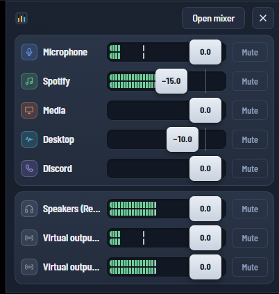

# Sleekmeeter

A modern face for Voicemeeter Standard, Banana and Potato. Sleekmeeter sits on top of Voicemeeter and controls it through the official Voicemeeter Remote API — Voicemeeter keeps doing the audio, Sleekmeeter is just a nicer mixer to look at and use.


**Mini mode and the tray volume panel:** one slim row per channel, with a meter, a fader and a mute button. Double-click the tray icon to open it right above the tray.



## Requirements

- Windows 10 or 11 (WebView2 comes with both)
- Voicemeeter Standard, Banana or Potato installed (Sleekmeeter loads `VoicemeeterRemote64.dll` from its install folder and adapts its layout to the edition you run)

## Run it

Sleekmeeter is portable: put `Sleekmeeter.exe` in any folder and run it. Scenes are saved in a `scenes` folder next to the exe.

If Voicemeeter isn't running, Sleekmeeter offers to start it. Closing the window keeps Sleekmeeter in the tray; left-click the tray icon to bring it back, right-click → **Quit Sleekmeeter** to exit. Only one copy runs at a time, so starting Sleekmeeter again (say, from a pinned taskbar icon) brings back the one that's already running.

## Using the mixer

| Do this | To |
| --- | --- |
| Drag a fader (hold **Shift** for fine moves) | Change level |
| Double-click a fader | Glide back to 0 dB |
| Right-click a fader (or press Enter on it) | Type an exact level, like `-10`, `-10db` or `+3 dB` |
| Scroll over a fader (**Alt** for 0.1 dB steps) | Nudge by 1 dB |
| Focus a fader, then ↑ ↓ / PgUp PgDn / 0 | Keyboard control |
| Click **A1–A3 / B1–B2** on an input | Route it to that output |
| Double-click a name (or F2) | Rename the strip or bus in Voicemeeter |
| Click a strip's icon | Open its panel: color, icon, hide, device, pan, compressor, gate, EQ (virtual inputs) or bus mode (outputs) |
| **Scenes** | Save or recall your whole Voicemeeter setup |
| **Rec** | Open Voicemeeter's recorder (Banana and Potato) |
| Pin button | Keep Sleekmeeter on top of other windows |
| Mini mode button | Switch to a small window with one row per channel |
| Gear button | Settings: themes, fades, talk-over ducking, audio devices, startup, volume overlay, updates and global shortcuts |
| **⋯** menu | Show the Voicemeeter window, restart the audio engine, clear solos |

Each strip is as wide as its name, so names show in full, and the input and output sections stay centred in the window. Click the dB readout under a fader to type an exact level.

Pick a theme in **Settings → Appearance**: **Console** (the dark hardware desk, the default), **Midnight** (deep blue), **Analog** (warm walnut and cream), **Studio** (a light desk with dark meter windows), **Minimal** (flat graphite, no glow) or **OLED black**, where everything that isn't information turns true black. The tray panel and the volume overlay follow the theme too.


Meters show post-fader levels on the same scale as the fader, so you can see signal and fader position together. Everything stays in sync with Voicemeeter itself, MIDI controllers and other remote apps.

### Smooth fades

Mute fades out before it mutes, and unmute fades back in, so nothing clicks or jumps. Typed levels, double-click to 0 dB, volume shortcuts and scene changes glide too. Set the mute and scene fade times in **Settings → Smooth fades**, or turn fades off there. Dragging a fader is always direct.

A scene fades its levels first and then loads everything else (routing, devices, EQ). Scenes saved before 0.6 load straight away the first time; after that they fade as well.

### Talk-over ducking

Turn other audio down while you talk, like a radio DJ. In **Settings → Talk-over ducking**, pick the channel that talks (usually your mic), the channels to turn down (music, game, desktop audio) and by how much. The **Starts at** slider lights up with your voice; put the knob just under your speaking level. When you stop talking, the channels fade back after the **Back after** time.

A ducked channel shows **Ducking** on its meter. Its fader stays at your level, so you can still move it while ducked, and moving it anywhere else (Voicemeeter's own window, a MIDI controller) takes it out of ducking. You can also add a shortcut that turns ducking on or off.

### Recorder

On Banana and Potato, **Rec** in the header opens Voicemeeter's built-in recorder: record, play, pause, stop, rewind and fast forward, with a running clock that also shows in the header while you record. Choose whether to record inputs or outputs and which ones, the file format and, for WAV, AIFF and BWF, the bit depth (MP3 always records at 16-bit, because Voicemeeter's MP3 encoder distorts at higher bit depths). A meter shows how loud the recording is; if it goes over 0 dB the file will distort, so the recorder warns you to turn down what you're recording (channels you record together are added up). To play a file, click **Open a file…** or drop an audio file on the window, then pick which outputs it plays into and its level. Recordings go to the folder set in Voicemeeter's own recorder menu. A shortcut can start and stop recording from any app.

### Devices that come back

Unplug USB headphones or let Bluetooth disconnect, and Voicemeeter often stays silent on that device after it comes back until you restart its audio engine. Sleekmeeter watches the devices Voicemeeter uses. When one of them comes back, it waits a couple of seconds for Windows to set it up, restarts the engine for you and shows a short message. Turn this off in **Settings → Audio devices**.

### Output profiles

Switching between headphones and speakers usually means picking the device on each output by hand. In **Outputs** (header), name the devices your outputs are using now, like *Headphones* or *Speakers*, and click a setup to switch to it. Only the output devices change; levels, routing and the rest stay as they are. Turn on **Auto** for a setup and Sleekmeeter switches to it when one of its devices connects, then restarts the audio engine so the device is picked up. Shortcuts can switch to a chosen setup or step to the next one.

### Push to talk and push to mute

In **Settings → Shortcuts**, set an action to **Push to talk (hold)** or **Push to mute (hold)**. These act only while you hold the keys. With push to talk, the mic starts out muted, opens when you press the keys and closes shortly after you let go; **Mic stays open** sets that delay so the end of a word isn't cut off. Push to mute does the opposite, and a channel you had already muted stays muted. If you remove a push-to-talk shortcut, unmute the mic yourself once.

### App volumes

**Apps** (header) lists the programs that are playing sound with a volume slider and a mute button each, like Windows' own volume mixer. It turns an app down before Voicemeeter hears it, which is handy for Discord, a browser or a game that has no volume control of its own. A green dot means the app is playing right now. Double-click a slider to put it back to 100%.

### Tray volume panel

Double-click the tray icon to open a small volume panel just above it: one fader and mute button per visible channel. It stays on top and can't be moved or resized; double-click the tray icon again or click **×** to close it, or **Open mixer** for the full window. A single click on the tray icon still shows or hides the mixer, and the tray menu has **Open volume panel** too.

### Shortcuts and the volume overlay

Global shortcuts work in any app. The defaults are **Ctrl+Alt+M** (mute input 1), **Ctrl+Alt+Up / Down** (A1 volume) and **Ctrl+Alt+S** (show or hide Sleekmeeter); change or add them in Settings, including hold-to-talk, switching output profiles, talk-over ducking and recording. When a level changes while Sleekmeeter isn't in front — from a shortcut, a MIDI controller or a Stream Deck — a small overlay shows which channel changed and its new level.

### Switching scenes automatically

In **Scenes → Switch automatically**, add a rule such as: when `obs64.exe` starts, load **Streaming**; when it closes, load **Default**. Sleekmeeter checks running apps every couple of seconds. If several rule apps are open, closing one goes back to the scene of the one started before it. Apps that are already running when Sleekmeeter starts don't trigger a switch.

### Updates

When Sleekmeeter starts it checks this repository's latest release. If there's a newer version, an **Update to …** button appears in the header; it opens the release page, or you can skip that version. Turn the check off in Settings.

### Startup

In Settings you can start Sleekmeeter with Windows (optionally straight to the tray), start Voicemeeter automatically, and hide Voicemeeter's own window when it starts. **⋯ → Show Voicemeeter window** always brings it back.

All of this is saved in `settings.json` next to the exe.

## Reporting a problem

**Settings → About** shows which version of Sleekmeeter you're running. Sleekmeeter also keeps a log of what it does and anything that goes wrong (events only, never audio): click **Open log file** there and attach `sleekmeeter.log` to your [issue](https://github.com/minimalhandle/SleekMeeter/issues). The log lives in a `logs` folder next to the exe (or in `%LOCALAPPDATA%\Sleekmeeter\logs` if that folder can't be written to) and never grows past about 2 MB.

## Build it

### Option A: GitHub Actions (no tools needed)

Push this folder to a GitHub repository. The included workflow (`.github/workflows/build-windows.yml`) builds on a Windows runner; download **Sleekmeeter-portable** from the run's Artifacts section.

### Option B: on your PC

1. Install [Rust](https://rustup.rs) (default MSVC toolchain, with the Visual Studio C++ build tools it asks for) and [Node.js](https://nodejs.org) 20+.
2. In this folder:
   ```
   npm install
   npm run build
   ```
3. The app is at `src-tauri\target\release\sleekmeeter.exe`.

For live development with Voicemeeter running: `npm run dev`.

## Preview the UI without Windows

Open `src/index.html` in any browser. With no Voicemeeter available it runs against a simulated Voicemeeter Banana. Add `?edition=1` (Standard) or `?edition=3` (Potato) to try the other layouts, `?panel` for the tray panel, `?update` for the update button, or `?offline` for the "not running" screen.

## How it works

- `src-tauri/src/vm.rs` finds Voicemeeter through its uninstall registry key, loads `VoicemeeterRemote64.dll`, and wraps the `VBVMR_*` functions (login, get/set parameters, levels, run).
- `src-tauri/src/main.rs` polls `VBVMR_IsParametersDirty` and `VBVMR_GetLevel` about 30 times a second, sends `vm-state` and `vm-levels` events to the window, and exposes commands for setting parameters and managing scenes.
- `src-tauri/src/gain.rs` works out fades, fading mute and ducking (Voicemeeter does the fading itself with `FadeTo`); `fades.rs` connects it to Voicemeeter and handles scene fades. `recorder.rs` drives the recorder, and `devwatch.rs` restarts the audio engine when a device comes back. `outputs.rs` keeps the output profiles, `hold.rs` handles push to talk and push to mute, and `appvol.rs` reads and sets each app's volume through Windows' audio sessions.
- `src-tauri/src/settings.rs` keeps settings in `settings.json`; `win.rs` handles start with Windows and Voicemeeter's window; `apps.rs` lists running apps for automatic scenes; `update.rs` checks GitHub for new releases.
- `src/` is the interface (plain HTML, CSS and JavaScript). `engine.js` talks to the Rust side inside the app, or to the simulator in a browser. `osd.html` is the volume overlay.

Parameter names follow the Voicemeeter Remote API documentation (e.g. `Strip[0].Gain`, `Strip[3].B1`, `Bus[0].Mute`), so adding more controls is mostly a matter of adding buttons that call `engine.setFloat(...)`.

## License

Sleekmeeter is released under the MIT License (see `LICENSE`).

## Credits

Uses the [Voicemeeter Remote API](https://github.com/vburel2018/Voicemeeter-SDK) by Vincent Burel / VB-Audio, free to use in projects that interact with Voicemeeter. Voicemeeter itself is donationware from VB-Audio. Font: Saira Semi Condensed (SIL Open Font License, see `src/fonts/OFL.txt`).

Sleekmeeter is an independent project and isn't affiliated with or endorsed by VB-Audio. Voicemeeter is a trademark of VB-Audio Software.
