# Sleekmeeter

A modern face for Voicemeeter Standard, Banana and Potato. Sleekmeeter sits on top of Voicemeeter and controls it through the official Voicemeeter Remote API — Voicemeeter keeps doing the audio, Sleekmeeter is just a nicer mixer to look at and use.

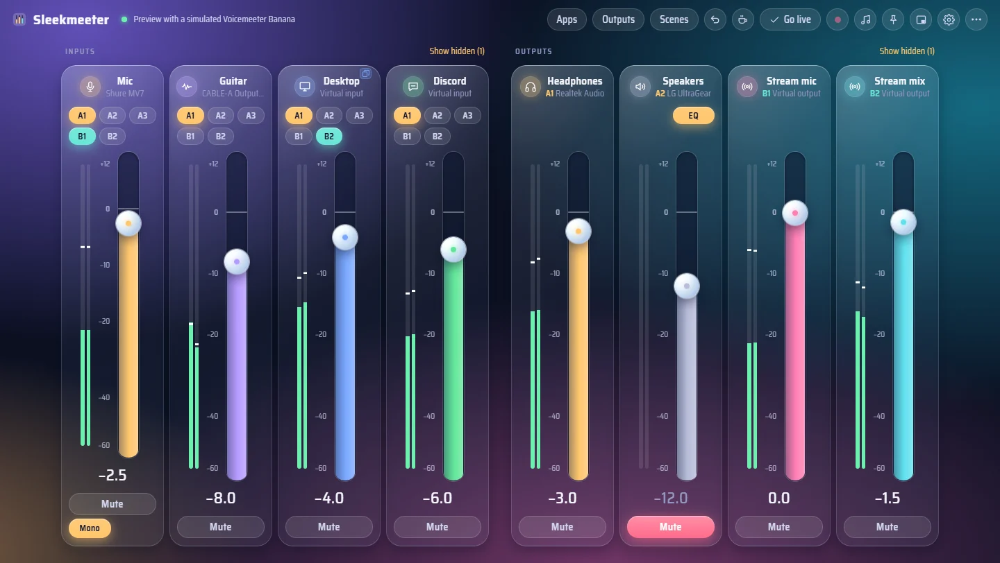

**Mini mode and the tray volume panel:** one slim row per channel, with a meter, a fader and a mute button. Double-click the tray icon to open it right above the tray.

<table>
<tr>
<td>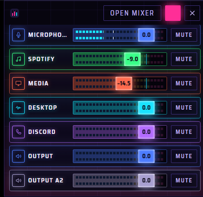</td>
<td>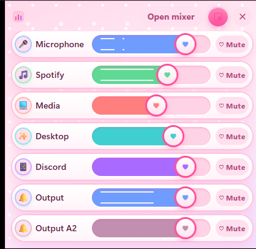</td>
</tr>
</table>

## New in 0.17.0

- **Output mix (Voicemeeter Potato):** every input's level on every output at once, like Voicemeeter's Streamer View, and it can pop out into its own window for a second screen. Untick **Show in Mix** in an output's settings to leave out outputs you don't use.
- **Swap route on Stream Deck:** one key switches between two routes, such as which mic goes to your Discord bus, or which headset your game plays on.
- **Per-output level keys:** a Stream Deck key can turn your game up in your headphones without touching your stream, and holding it keeps stepping.
- **Now Playing works everywhere:** including Apple Music and browser players, on PCs where it showed nothing before.
- **What's new and Check for updates:** see what changed after each update, and check for a new version without restarting.

See the [changelog](CHANGELOG.md) for everything in this version.

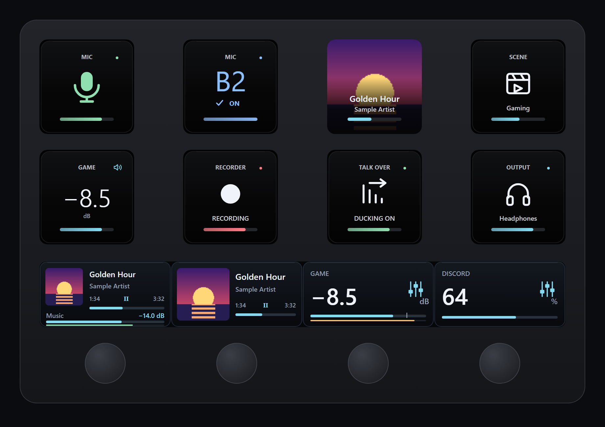

*The Stream Deck plugin, drawn with sample data. More in the [Stream Deck section](#stream-deck).*

## Requirements

- Windows 10 or 11 (WebView2 comes with both)
- Voicemeeter Standard, Banana or Potato installed (Sleekmeeter loads `VoicemeeterRemote64.dll` from its install folder and adapts its layout to the edition you run)

## Install or run it

Pick one from the [Releases](../../releases) page:

| File | What it is |
| --- | --- |
| **Sleekmeeter-*version*-setup.exe** | The easy way: a normal installer window that installs just for you, with no administrator rights. If Voicemeeter isn't installed, it tells you and offers to open VB-Audio's download page. |
| **Sleekmeeter-*version*.msi** | The same, installed for all users in Program Files (asks for administrator rights). If you used this before, uninstall the old copy in Windows Settings → Apps first; your settings are kept. |
| **Sleekmeeter-*version*-portable.zip** | No install: unzip anywhere and run `Sleekmeeter.exe`. Settings and scenes are saved in a `scenes` folder next to the exe. |

Voicemeeter is made by VB-Audio and is not included; the installer links you to vb-audio.com. After you install Voicemeeter, Windows needs a restart before Voicemeeter's audio drivers work.

When installed (either way), your settings, scenes and logs are kept in `%APPDATA%\Sleekmeeter` instead, so updates never touch them.

If Voicemeeter isn't running, Sleekmeeter offers to start it. Closing the window keeps Sleekmeeter in the tray; left-click the tray icon to bring it back, right-click → **Quit Sleekmeeter** to exit. Only one copy runs at a time, so starting Sleekmeeter again (say, from a pinned taskbar icon) brings back the one that's already running.

## Using the mixer

| Do this | To |
| --- | --- |
| Drag a fader (hold **Shift** for fine moves) | Change level |
| Double-click a fader | Glide back to 0 dB |
| Right-click a fader (or press Enter on it) | Type an exact level, like `-10`, `-10db` or `+3 dB` |
| Scroll over a fader (**Alt** for 0.1 dB steps) | Nudge by 1 dB |
| Focus a fader, then ↑ ↓ / PgUp PgDn / 0 | Keyboard control |
| Click **A1–A3 / B1–B2** on an input | Route it to that output |
| Double-click a name (or F2) | Rename the strip or bus in Voicemeeter |
| Click a strip's icon | Open its Routing, Sound, Apps or Appearance settings |
| **Scenes** | Save or recall your whole Voicemeeter setup |
| **Stream** menu | Go-live check, Be right back, Recorder (Banana and Potato), Soundboard and configured stream tools |
| Pin button | Keep Sleekmeeter on top of other windows |
| Mini mode button | Switch to a small window with one row per channel |
| Gear button | Searchable Settings, with categories for appearance, mixing, microphones, streaming, remote controls and system options |
| **⋯** menu | Grouped audio tools and appearance options, including Focused mixer |
| **Ctrl+K** | Open Quick Actions and search for a channel, scene, output profile, tool or setting |

Use **Pin** beside an action in the Stream menu to put it on the toolbar. Live, recording, and BRB indicators give you shortcuts to their controls. Click the Voicemeeter status indicator to open **Check my setup**. **Settings → Streaming → Streamer mode** controls whether the Stream menu and pins appear.

**⋯ → Audio Event History** shows playback device changes, output fallbacks, app route recovery and VST3 quarantine. Filter the timeline and select an event to open the relevant controls. The latest 200 events are stored locally and can be cleared from the timeline.

Settings search looks across all categories. On narrow windows, categories move into a grid above the settings. For a clean install, Sleekmeeter opens in the foreground, offers to start Voicemeeter if needed and uses Subtle theme motion. Level history and talking-while-muted alerts are opt-in. Existing settings keep their previous choices.

**Settings → Appearance & layout → Show output names on the routing buttons** labels them with your outputs' names (*Headphones*, *Stream mix*) instead of A1 or B2. Hover over one for the full name.

Channels use a consistent width to keep the mixer tidy, and the input and output sections stay centred in the window. Long names are shortened with an ellipsis; hover over a name to read it in full. Click the dB readout under a fader to type an exact level.

### Themes

Choose from twelve themes in **Settings → Appearance & layout → Appearance**, ordered from dark to light. Use **Show all 12 themes** to browse the full lineup. The mixer, mini mode, tray panel, and volume overlay follow your selection. **Theme motion** offers Off, Subtle, or Full for Glass, Hadal, Kokiri Forest, Neon, and Arcade. Windows reduced motion takes priority.

<table>
<tr>
<td align="center" valign="top">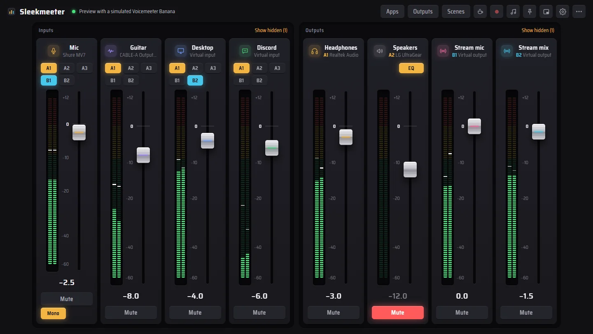<br><sub><b>Console</b> (default)</sub></td>
<td align="center" valign="top">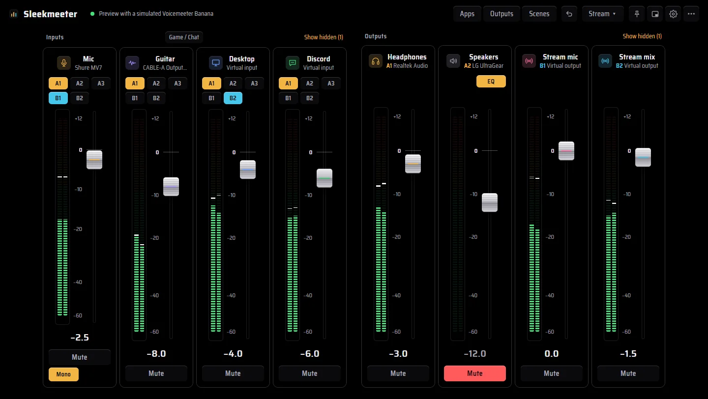<br><sub><b>OLED black</b></sub></td>
<td align="center" valign="top">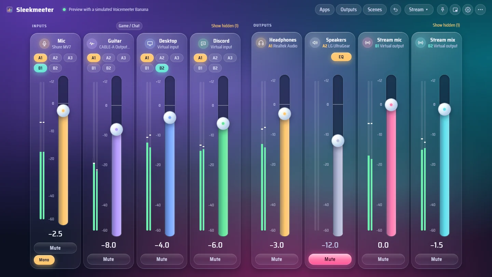<br><sub><b>Glass</b></sub></td>
</tr>
<tr>
<td align="center" valign="top">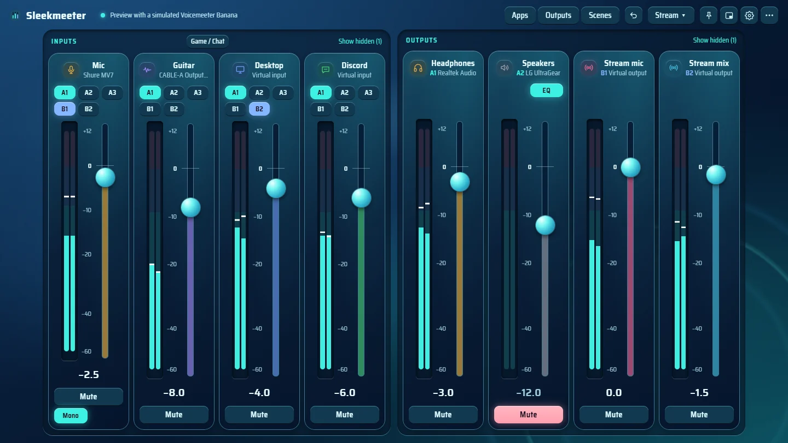<br><sub><b>Hadal</b></sub></td>
<td align="center" valign="top">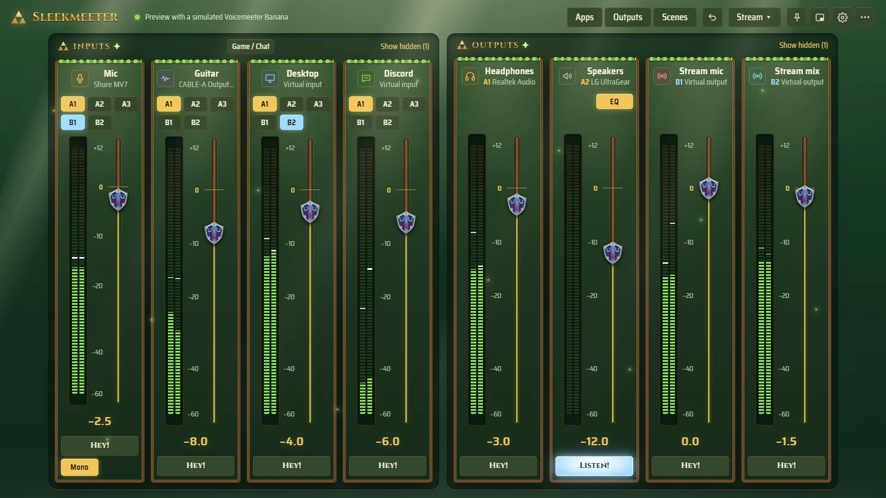<br><sub><b>Kokiri Forest</b></sub></td>
<td align="center" valign="top">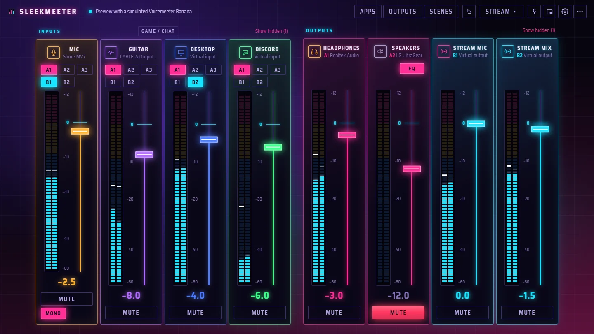<br><sub><b>Neon</b></sub></td>
</tr>
<tr>
<td align="center" valign="top">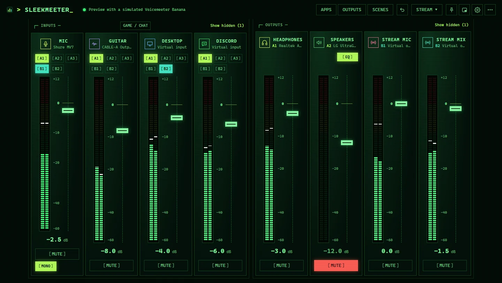<br><sub><b>Terminal</b></sub></td>
<td align="center" valign="top">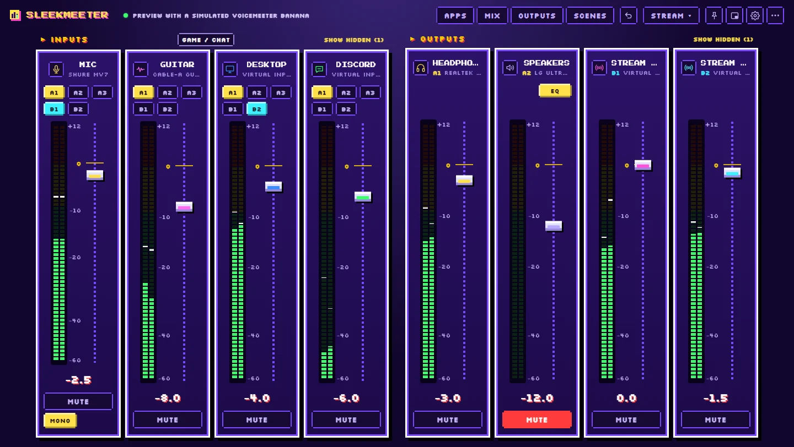<br><sub><b>Arcade</b></sub></td>
<td align="center" valign="top">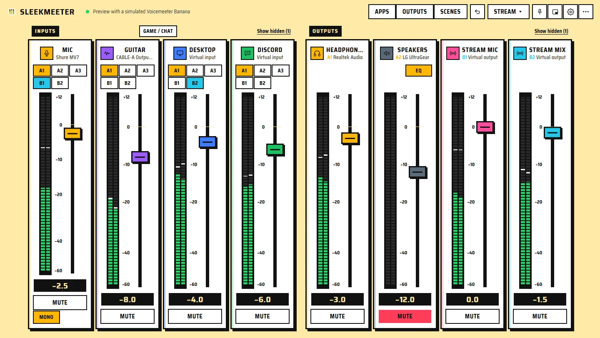<br><sub><b>Block</b></sub></td>
</tr>
<tr>
<td align="center" valign="top">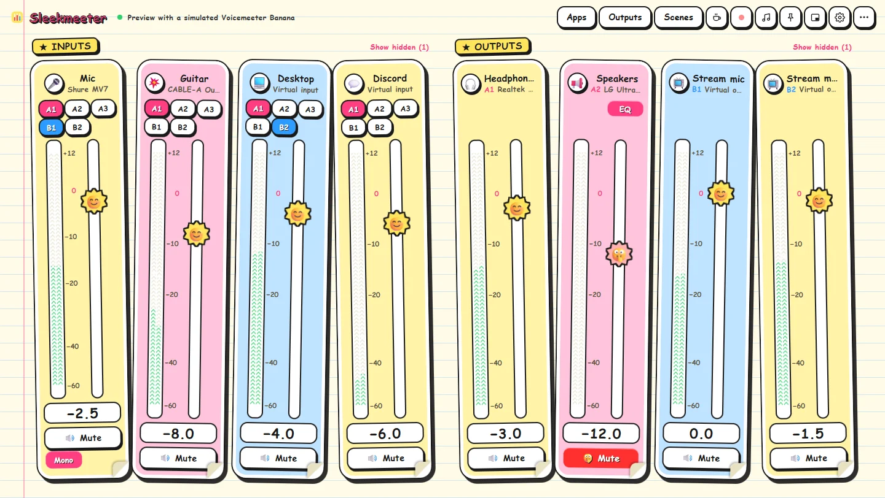<br><sub><b>Sticker Bomb</b></sub></td>
<td align="center" valign="top">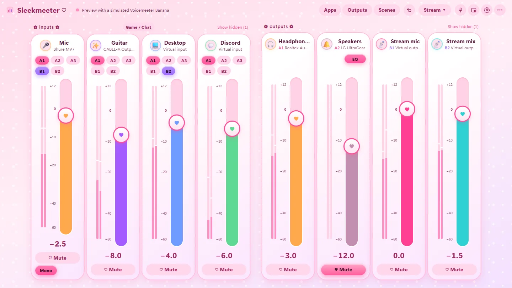<br><sub><b>Bubblegum</b></sub></td>
<td align="center" valign="top">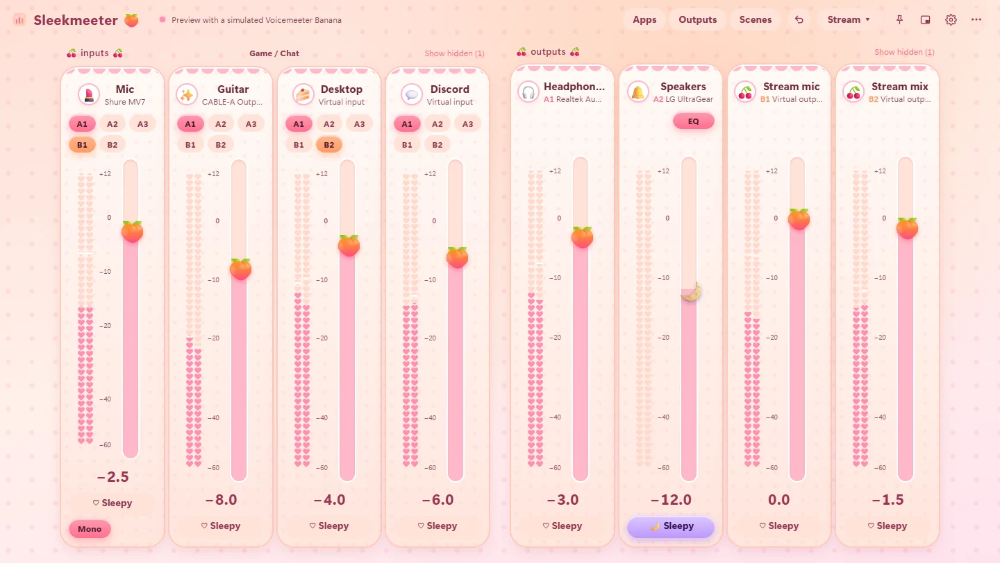<br><sub><b>Peaches &amp; Cream</b></sub></td>
</tr>
</table>

Meters show post-fader levels on the same scale as the fader, so you can see signal and fader position together. Everything stays in sync with Voicemeeter itself, MIDI controllers and other remote apps.

### Rearranging channels

Drag the top of any channel (its icon and name area) left or right to move it, so you can put Desktop at the end and Aux before it, or keep the channels you use most together. Inputs and outputs are ordered separately, and mini mode follows the same order. **⋯ → Reset channel order** puts everything back as Voicemeeter has it. Turn on **Settings → Appearance & layout → Channel arrangement → Lock channel arrangement** to prevent accidental reordering; faders and buttons keep working.

Click a channel's name to hide or show the device line under it (for example "CABLE-A Output"). Double-click the name to rename it.

### Listening EQ and Steadier volume

Each output's and input's **Sound** tab (click its icon) has an **EQ preset** and **Steadier volume**:

- **EQ presets:** **Footsteps** (less rumble, more of the range footsteps and reloads are in), **Bass boost**, **Voice clarity**, **Brighter**, **Warmer** and **Late night** (less bass through the walls).
- **Steadier volume:** **Gentle** evens out big jumps; **Night mode** brings loud explosions down and quiet dialogue up so you can keep the volume low. Both have a safety limiter, and they don't lift silence or hiss.

They run inside Voicemeeter's audio with no added delay, on Standard, Banana and Potato, while Sleekmeeter is open. They use Voicemeeter's audio insert, like mic clean-up, so another app holding the output insert stops them on outputs until it closes.

### A different mix on each output (Potato)

Voicemeeter Potato can give every input its own level on each output (its "gain layers"), so your stream can hear less game than your headphones do, the way VB-Audio's Streamer View works. **Mix** in the header shows every input's level on every output at once, like Streamer View, with each output's on/off button under its slider. The button next to its close button pops it out into a window of its own, for example to keep it on a second screen; it reopens where you left it. You can also open an input's settings (click its icon) and use **Level on each output**, or choose an output in **Faders set** above the inputs: the input faders then set that output's mix, and **All outputs** goes back to normal. Moving an input's main fader, muting it, ducking, scenes and Be right back all keep the differences between outputs. Scenes save and restore these per-output levels too (Voicemeeter's own scene file doesn't keep them), and on a Stream Deck the **Output mix** dial, **Faders set** key and **Level step** key (with an output picked) do the same from hardware. Inputs on Banana and Potato also have Voicemeeter's **limiter** under Dynamics in their settings.

On Banana and Standard, **Mix** opens **Your mix and your stream** instead: ways to keep an input or your music off stream, turn the whole stream down, and balance game against chat, which together cover most of what a separate mix is for.

### Smooth fades

Use **Undo mixer change** in the toolbar or **Ctrl+Z** to reverse recent mixer fader, mute, and routing edits made in that window. A linked fader move or drag counts as one change. Undo skips an action if its affected controls have since changed.

In **Settings → Mixer & devices → Linked fader groups**, add a group and choose its channels. Main faders in a group move by the same dB until one reaches its limit. Per-output input mixes are independent. Hold **Alt** when you start dragging or when using the wheel or fader keys to adjust just one member.

Open **Game / Chat** beside the mixer inputs or in Potato's **Mix** window. Choose separate inputs and use **Set up game and chat apps** to assign the Windows apps and verify their playback paths. On Potato, send both inputs to the selected hardware listening output in Normal mode. The slider changes only that output's gain layers and shows the levels Voicemeeter reports. Standard and Banana use the main input faders, which affect all routes. The end stops put the opposite fader at minimum. **Restore centre** keeps independent fader edits and remembers the centre across restarts. On Potato, **Copy main levels to listening output** can recover levels left low by an older build. Save the assignments to use the optional pinned slider and shortcuts in **Controls & remote**.

Use **Listen to a mix** from **Outputs** or the Potato **Mix** window to hear a virtual output live. Pick a separate physical playback device. Monitoring plays at reduced volume, leaves your routes alone and stops when you close the monitor.

To mute an input on some outputs only, right-click its **Mute** (in the mixer or the tray panel) and pick the outputs, for example **Mute on B1** to mute your mic in Discord while your stream still hears you. The Mute button gets a red outline listing those outputs, and unmuting turns back on exactly the ones it turned off. On Potato it fades the input's level on that output first (with the mute fade time), and that level comes back as it was; on Standard and Banana the switch is instant.

To make one of those destinations the normal left-click action, open the input’s **Routing → Mute button destination** and choose Everyone, Audience, Headphones, or Voice chat. For Voice chat, select its virtual output.

Use **Cue in headphones** from the input’s **Sound** tab to hear the input before its fader and effects. Cue uses the Windows endpoint and plays to a physical device without changing the Voicemeeter sends. Select headphones outside your streaming app’s desktop capture. **Listen to a mix** has Personal and Stream buttons. For an isolated comparison, select a separate playback device and use the personal output’s recording mirror if available.

**Settings → Streaming → OBS Studio → Check audio tracks** reads the current OBS profile and shows which audio sources share the live, VOD and recording tracks. It flags overlapping capture paths for review.

Mute fades out before it mutes, and unmute fades back in, so nothing clicks or jumps. Typed levels, double-click to 0 dB, volume shortcuts and scene changes glide too. Set the mute and scene fade times in **Settings → Mixer & devices → Smooth fades**, or turn fades off there. Dragging a fader is always direct.

A scene fades its levels first and then loads everything else (routing, devices, EQ). Scenes saved before 0.6 load straight away the first time; after that they fade as well.

### Talk-over ducking

Turn other audio down while you talk, like a radio DJ. In **Settings → Mixer & devices → Talk-over ducking**, pick the channel that talks (usually your mic), the channels to turn down (music, game, desktop audio) and by how much. Under **Or when these talk** you can add more channels, such as Discord, so the game also turns down when a friend speaks. The **Starts at** slider lights up with your voice; put the knob just under your speaking level. When you stop talking, the channels fade back after the **Back after** time.

A ducked channel shows **Ducking** on its meter. Its fader stays at your level, so you can still move it while ducked, and moving it anywhere else (Voicemeeter's own window, a MIDI controller) takes it out of ducking. You can also add a shortcut that turns ducking on or off.

### Recorder

On Banana and Potato, the record button (red dot) in the header opens Voicemeeter's built-in recorder: record, play, pause, stop, rewind and fast forward, with a running clock that also shows in the header while you record. Choose whether to record inputs or outputs and which ones, the file format and, for WAV, AIFF and BWF, the bit depth (MP3 always records at 16-bit, because Voicemeeter's MP3 encoder distorts at higher bit depths). A meter shows how loud the recording is; if it goes over 0 dB the file will distort, so the recorder warns you to turn down what you're recording (channels you record together are added up). To play a file, click **Open a file…** or drop an audio file on the window, then pick which outputs it plays into and its level. Recordings go to the folder set in Voicemeeter's own recorder menu. A shortcut can start and stop recording from any app.

### Devices that come back

Unplug USB headphones or let Bluetooth disconnect, and Voicemeeter often stays silent on that device after it comes back until you restart its audio engine. Sleekmeeter watches the devices Voicemeeter uses. When one of them comes back, it waits a couple of seconds for Windows to set it up, restarts the engine for you and shows a short message. Turn this off in **Settings → Mixer & devices → Audio devices**.

### Fix my audio

Plug devices in, especially in a different order, and Windows may start playing sound straight to one of them instead of to Voicemeeter. Apps then skip the mixer and its channels go quiet. Sleekmeeter notices when Windows' sound output isn't one of Voicemeeter's inputs and shows a red **Fix my audio** button in the header and in **Check my setup**. One click switches Windows back to the Voicemeeter input it was using and restarts the audio engine. Turn on **Settings → Mixer & devices → Audio devices → Keep Windows sound on Voicemeeter** to have this happen by itself. Windows' device for calls is checked and switched too, so apps like Discord also go through the mixer.

### Privacy and the user count

Sleekmeeter asks once whether you'd like to be counted as a user. If you say yes, it sends sleekmeeter.app one small message a day: a random ID made on your PC, the Sleekmeeter version and your Voicemeeter edition (Standard, Banana or Potato). That's all: no names, devices, settings, audio or anything about your PC. The server keeps one line per ID per day, doesn't store IP addresses, and deletes lines after 400 days. Turn it on or off any time in **Settings → System & backup → Privacy**; turning it off deletes the ID. The totals are public at [sleekmeeter.app/api/stats](https://sleekmeeter.app/api/stats), and the server code is in [`server/usage`](server/usage).

### Output profiles

Open **Outputs → Device fallback chains** to rank WDM, KS, or MME playback devices for a hardware output. The chain switches to its first available device and returns to higher-priority devices after they settle. Choosing a device outside the list suspends the chain for that output.

**Outputs → Current devices** shows what each hardware bus uses and the reason for its fallback selection. **Fallbacks…** opens the policy for that bus.

Copy a policy to give another output its own list, or link it to share future changes. Unlinking keeps a copy. The editor shows the preferred available device and why the output is using it or waiting to switch.

Switching between headphones and speakers usually means picking the device on each output by hand. In **Outputs** (header), name the devices your outputs are using now, like *Headphones* or *Speakers*, and click a setup to switch to it. Only the output devices change; levels, routing and the rest stay as they are. Turn on **Auto** for a setup and Sleekmeeter switches to it when one of its devices connects, then restarts the audio engine so the device is picked up. Shortcuts can switch to a chosen setup or step to the next one.

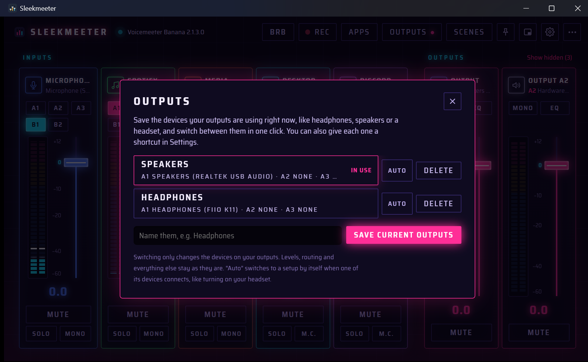

### Push to talk and push to mute

In **Settings → Controls & remote → Shortcuts**, set an action to **Push to talk (hold)** or **Push to mute (hold)**. These act only while you hold the keys. With push to talk, the mic starts out muted, opens when you press the keys and closes shortly after you let go; **Mic stays open** sets that delay so the end of a word isn't cut off. Push to mute does the opposite, and a channel you had already muted stays muted. If you remove a push-to-talk shortcut, unmute the mic yourself once.

### App volumes

**Apps → Volumes** lists programs with Windows audio sessions. A green dot means the app is playing right now. Double-click a slider to put it back to 100%.

**Send an app to another output.** The box on the right of each app chooses which playback device it plays to, for example Discord into a Voicemeeter virtual input, the same setting as Windows' *App volume and device preferences*. This one is new and uses an internal Windows feature, so if your version of Windows doesn't accept it you'll see a message instead and nothing changes.

### Apps tray: drag an app onto a channel

Select **Apps → Volumes → Show apps tray** to open the tray along the bottom. Drag an app chip onto a channel to play that app through its fader. A small stack icon marks routed apps, or a green rupee in Kokiri Forest. Hover over the input to see its apps, or click the icon to keep the list open. The channel’s **Apps** tab also lists its assignments. Use **×** in the popover, **Remove** in the drawer, or drag the chip back to the tray to restore the Windows default. **Volumes…** on the tray reopens the Apps workspace.

Which channels accept apps: Voicemeeter's own virtual inputs (VAIO, AUX and, on Potato, VAIO3), and any hardware input that listens to a virtual cable such as VB-Cable. For a cable channel Sleekmeeter sends the app to the other end of that cable (CABLE-A Input for a channel listening to CABLE-A Output). You hear it the usual way: with the channel's A1 (or A2…) button on. Channels with a real microphone or other hardware, and outputs, can't take apps.

In **Apps → Audio Flow → Audio route inspector**, choose an app to trace its Windows playback device, Voicemeeter input, and enabled outputs. The trace flags mute, minimum levels, missing devices, and inputs without enabled routes.

**Audio Flow** shows those paths together. Select an app, input, or output to highlight its connections. Dotted lines mark estimated or interrupted routes. **Apps → Saved assignments** accepts an executable name or a browsed `.exe`. The assignment takes effect when the app opens a Windows audio session.

Open **Guided audio test** there to play distinct tones through your game and chat inputs, or send a tone through an input and hear the recording from your stream bus. Choose a physical playback device for stream and mic playback. The mic comparison captures the same four-second take before and after an active Sleekmeeter chain, matches the playback levels, and keeps the take in memory while the test is open.

In **Scenes**, choose a saved scene to preview differences in levels, mutes, routing, and mic-chain controls before pressing **Apply scene**. Older scenes may only have level data. Save them again to capture routing for future previews.

Some programs only move when their sound restarts, so pause and play once if one doesn't switch straight away. Windows has no public setting for this, so Sleekmeeter uses the same call Windows' own "App volume and device preferences" page uses, run in a separate helper so a problem can't crash Sleekmeeter.

### Stream mode: Be right back

**Stream → Be right back** fades the channels you pick, such as muting your mic and turning down your game. Use **Back live** or click **BRB** in the header to restore the mix. Configure it in **Settings → Streaming → Stream mode: Be right back**. A shortcut or an OBS scene can toggle it too.

### OBS Studio

In **Settings → Streaming → OBS Studio**, connect Sleekmeeter to OBS (in OBS turn on **Tools → WebSocket Server Settings → Enable WebSocket server**; add the password there if you set one). Then you can pick what happens when OBS switches to a scene, like loading a Voicemeeter scene, or starting or ending Be right back when you switch to your BRB scene. You can also choose what happens when you go live and when the stream ends, and a red **LIVE** tag shows in the header while OBS is streaming. Twitch streams are covered because OBS tells Sleekmeeter when it goes live. Sleekmeeter only listens; it never changes anything in OBS. This needs OBS Studio 28 or newer.

### Going live

**Settings → Streaming → Going live** has the things that catch stream mistakes before chat does. They all use the output your stream gets (**Stream gets**: B2 unless you change it).

- **"You're muted":** talk into a muted mic and the overlay says so, even with Sleekmeeter in the tray, and the mic's strip flashes red. It stays quiet while Be right back is on and while a push-to-talk key is up (tick the box to be told then too). It's on by default. If it pops up when you're not talking, raise **Louder than**.
- **Go-live check:** open it from **Stream** to check your mic, stream output, OBS link, Windows audio routing, Twitch chat, and Instant replay. The OBS link can also run it automatically when you start streaming.
- **Silent stream warning:** a warning on the overlay when the stream output has had no sound for 5 to 60 seconds, and if you like when it clips. By default only while OBS says you're live.
- **Music off stream:** keeps your music out of the stream (and your VODs) while you still hear it. Play your music app into one channel (drag it there under **Apps**), choose that channel, and choose when: while you're live, while OBS records, either, or only when you press its key. Sleekmeeter switches that channel's button for the stream output off (with a fade on Potato) and back on afterwards. The music key in the header, a shortcut, a Twitch command or Sleekmeeter Remote switches it by hand until OBS next starts or stops. Turning the button back on yourself also ends it.

### Instant replay

Turn on **Settings → Streaming → Instant replay** and Sleekmeeter keeps the last 15 to 120 seconds of your stream output in memory. Press the replay button in the header (or a shortcut, a Twitch command such as `!clip`, or Sleekmeeter Remote) and they're saved as a WAV file in **Music\Sleekmeeter replays**, for clipping a funny moment without OBS's replay buffer. Nothing is written to disk until you save, and nothing leaves your PC. It listens to the stream output through Windows (**Voicemeeter Out B2**); pick another of Voicemeeter's outputs under **Of**.

### Mic level

**Settings → Microphone → Mic Chain & levels → Check my mic level** listens while you talk for 8 seconds and tells you whether your mic is too quiet, about right or too loud, and can set the fader for you. It aims to keep your voice peaking around −10 dB with room for a laugh or a jump scare. You can also turn on a warning when a channel goes over 0 dB, where audio distorts.

**Guided tune-up** is inside **⋯ → Mic Chain**, also accessible from **Settings → Microphone → Mic Chain & levels**. It measures room tone, normal speech and a loud phrase using meter readings. Choose which suggestions to apply, or preview them for eight seconds. Preview changes are heard on the input’s existing routes, including stream sends. Sleekmeeter restores the previous values unless you keep the preview.

### Mic clean-up (NVIDIA)

With an NVIDIA RTX graphics card, **Settings → Microphone → Clean-up and plugins** removes background noise (keyboard, fans, the dog), room echo, or both from your mic using NVIDIA's AI on the graphics card. It's much stronger than Voicemeeter's own denoiser. Pick the mic (one of Voicemeeter's hardware inputs) and how strong it should be; Settings shows whether it's running and how much delay it adds (about 25 ms).

It runs inside Voicemeeter, before the fader, gate and compressor, so every output gets the clean voice. Sleekmeeter does the work, so it only runs while Sleekmeeter is open; if Sleekmeeter closes, your mic carries on without it. It needs:

- NVIDIA's free **Audio Effects SDK** runtime for your card, from NVIDIA's Maxine developer site. Sleekmeeter doesn't include or download it, and only loads it while mic clean-up is on (it uses some memory on the graphics card).
- Voicemeeter running at 48 kHz (**Menu → System Settings → Preferred Main SampleRate**).
- No other app using Voicemeeter's audio insert at the same time.

**Speakers instead of headphones?** Tick **Remove my speakers from this mic** and pick the output your speakers are on (A1 unless you change it). NVIDIA's echo removal hears what the speakers play and takes it out of the mic, so your game and friends don't echo back to your stream or Discord. It can run with or without the noise removal.

**More than one mic:** **+ Add a mic** gives another of Voicemeeter's hardware inputs its own clean-up and plugins, for example a guest mic. Each mic has its own tab; a green dot means it's running.

**Your friends' voices too:** **+ Chat or app input** cleans up a virtual input, such as the one Discord plays into, so you don't hear your friends' keyboards and fans. Choose **Voices** for voice chat (left and right are cleaned as one voice) or **Stereo** for music and games, where you can use VST3 plugins. Up to five mics, inputs and outputs can have clean-up or plugins at once.

**Hear the difference:** **Listen to this mic** sends the mic to A1 (usually your headphones) while you set it up, and switches A1 back off when you stop. Hold **Hold to hear it without** to hear the mic raw, with the same delay, and let go to hear the clean-up again.

**Switch it from anywhere:** a shortcut, the **Mic clean-up** Stream Deck key, Sleekmeeter Remote or a Twitch command (**Mic clean-up on or off**) switches one mic's clean-up and plugins off and back on, or every mic at once. Scenes remember which mics have it on and how strong NVIDIA's clean-up is, so a podcast scene can use a lighter touch than a loud game.

### VST3 plugins on your mic

**On an output:** **+ An output** in **Settings → Microphone → Clean-up and plugins** (or **Add VST3 plugins to this output…** in an output's **Sound** tab) runs your own VST3 plugins on that output, for example a spatial audio or headphone EQ plugin on A1. Outputs are always stereo, and plugins there add a little delay, so leave the outputs your stream or recording uses alone unless you want the effect there too.


For a capture card or another stereo hardware source, add its input in **Settings → Microphone → Clean-up and plugins**, choose **Stereo hardware input**, then add a VST3 effect with stereo input and output. This mode keeps left and right separate. NVIDIA mic processing is available in the mono microphone mode.

If the helper crashes during a tracked plugin load or audio call, Sleekmeeter bypasses the plugin involved and restarts the remaining chain. Quarantine is saved across restarts. Use the recovery panel in **Settings → Microphone → Clean-up and plugins** to bypass a plugin manually or retry a bypassed plugin.

In **Portable chain preset**, export the selected mic's NVIDIA effect settings, ordered VST3 list and plugin state as JSON. On the destination PC, select the mic and preview the import. Sleekmeeter matches VST3 effects by identity against local installations, flags missing or quarantined plugins, and shows whether the NVIDIA runtime is installed before you apply the chain.

**Settings → Microphone → Clean-up and plugins** can also run your own VST3 effects on the mic, like an EQ, a de-esser, a compressor or a limiter, with no separate plugin host and no ASIO insert setup. **Add a plugin…** lists the effects installed in the usual VST3 folders (`C:\Program Files\Common Files\VST3`, and `%LOCALAPPDATA%\Programs\Common\VST3` for plugins installed just for you); **Browse for a .vst3 file…** picks one from anywhere else.

- Plugins run top to bottom, after NVIDIA's clean-up if that's on. Use the arrows to reorder them, the tick to switch one off, and **Edit** to open its own window.
- Each plugin's settings are saved as you change them and come back after a restart.
- **Presets:** a plugin's **Presets** menu saves its current settings under a name, and loads them again, on any mic that has the same plugin.
- They get your mic in mono (or the same signal on both sides, for stereo-only plugins), and work at whatever rate Voicemeeter runs.
- Like the NVIDIA clean-up, they run inside Voicemeeter before its fader, and only while Sleekmeeter is open.
- **Crash-safe:** plugins run in a separate helper (a second `sleekmeeter.exe`), so a plugin that crashes doesn't take Sleekmeeter or your mic with it. Your mic carries on without plugins, Settings says what happened, and the plugins start again. After three crashes in two minutes they stay off for a while, so you can switch off or remove the one that crashes. A plugin that stops answering is skipped rather than allowed to hold up your mic.
- VST3 only: older VST2 plugins (`.dll` files) aren't supported.

### Per-game profiles

**Scenes → Switch automatically** rules can do more than load a scene. Under each rule, pick an **output profile** and a **theme** to use while the app runs: for example, when `valorant.exe` starts, load *Gaming*, switch to *Headphones* and use the Neon theme. When the last app with a rule closes, your scene, outputs and theme go back.

### Backup, layout and the setup check

**Voicemeeter backups:** once a day, and before loading a scene, running the setup assistant or restoring a backup, Sleekmeeter saves a copy of Voicemeeter's whole setup (the last 14 daily copies and 10 others are kept). **Settings → System & backup → Backup and layout** lists them; **Restore** puts one back after saving your current setup, so you can undo it.

**Settings → System & backup → Backup and layout** saves your settings to a file and restores them (your scenes are the .xml files in the `scenes` folder next to Sleekmeeter, so copy that too), and **Reset the layout** brings the window back to its default size and unhides every channel. **Settings → System & backup → About → Check my setup** (also on the "Voicemeeter isn't running" screen) checks the things that usually go wrong: Voicemeeter and its remote library, audio devices Windows doesn't list, shortcuts that couldn't be registered, the OBS link, and whether settings can be saved.

### Soundboard

Click the note button (**Sounds**) in the header to play short clips into your stream: an airhorn, a sad trombone, a bit of music. **Add sounds…** takes one or several wav, mp3, ogg or flac files (hold Ctrl or Shift to pick more than one) and turns each into a button, and **Add a folder…** adds every sound inside a folder and its subfolders in one go. Sounds are copied into a `sounds` folder next to Sleekmeeter's settings, so you can move or delete the originals afterwards. Sounds you already added are skipped. Sounds play to the output device you pick under **Play to**. Choose one of Voicemeeter's virtual inputs (like *Voicemeeter Aux Input*) and each sound shows up in the mixer as a channel of its own, so you decide where it goes (stream, headphones or both) and turn it up or down with its fader. **Automatic** picks a Voicemeeter virtual input for you when there is one. **Edit** renames or removes sounds.

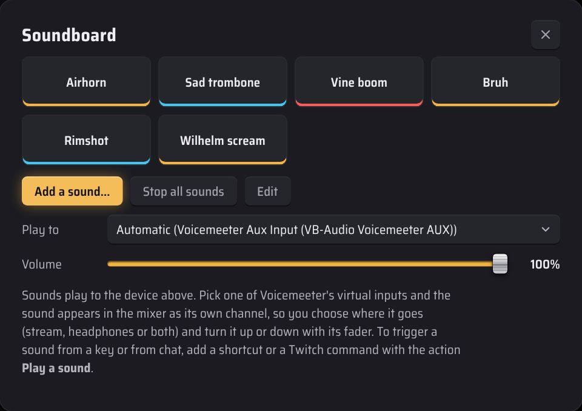

In **Edit** mode every sound also gets a **Group** box and a **Key** button. Type a group name (Memes, Alerts, Music) and a tab bar appears above the buttons so a big board stays easy to scan, and press **Key** to give that one sound its own shortcut that works from any app. **Random pack…** turns a whole folder into a single button (marked with a dice) that plays a different sound from the folder each press and never repeats the one before: handy for ten different cheers or fail sounds.

Sounds can also be played from a **shortcut** or a **Twitch chat command** (the action *Play a sound*).

### Mic chain, setup assistant and hear-yourself test

The **⋯** menu in the header has three helpers for a good stream voice:

- **Mic chain…** has sliders for the noise gate, compressor and denoiser on your microphone, with one-click presets (**Streamer voice**, **Gentle**, **Noisy room**, **All off**) and a live meter so you can watch the effect. Only the controls your Voicemeeter edition has are shown, and Potato also gets threshold and ratio sliders. Compressor threshold runs from −40 to −3 dB; gate threshold runs from −60 to −10 dB.
- **Setup assistant…** sets the A1 and B1 routing buttons for you. Choose **Just gaming + chat** (you hear everything, friends hear only your mic) or **Streamer + Discord** (the same, plus a second mix on B2 for OBS), pick your mic and your Discord channel, check the list of what will change and press **Apply routing**.
- **Hear yourself…** records 5 seconds of your stream mix (one of Voicemeeter's virtual outputs, B2 by default) and plays it back on your headphones, so you hear exactly what your viewers hear.

### Recorder and Voicemeeter options

The record button opens the recorder: transport buttons, which channels to record, the file format and bit depth, **Channels** (mono up to 7.1), **Sample rate**, **MP3 quality**, and **One file per channel** for multitrack. Under **Play a file** you can repeat the file, start it as soon as it loads, and **Jump to** a time like `1:30`.

**⋯ → Voicemeeter options…** shows the settings from Voicemeeter's System Settings window: sample rate, buffer sizes, exclusive and swift modes, monitor-on-select and the delay for each output. Changing the sample rate or a buffer restarts Voicemeeter's audio engine, so sound cuts out for a moment.

### OBS overlay

Under **Settings → Controls & remote → Sleekmeeter Remote** there is a second address for OBS. Add a **Browser** source in OBS, paste the address and you get a see-through overlay with a red **MUTED** or amber **BRB** badge, a meter for your mic and the name of the sound that just played. It works while Sleekmeeter is in the tray. If your mic isn't the first channel, add `&mic=1` (second channel), `&mic=2` and so on to the address, and use `&show=badge,meter` to pick which parts appear. It uses the same secret key as Sleekmeeter Remote, so keep the address private.

### Twitch chat commands

Let chat, or just your mods, run things while you stream. In **Settings → Streaming → Twitch chat commands**, enter your channel name and add commands such as `!brb` (Be right back), `!scene` (load a scene) or `!sound` (play a sound). Leave the last box empty and the command uses what's typed after it, so `!sound airhorn` plays *airhorn* and `!scene Gaming` loads *Gaming*. Other actions include muting a channel, switching output profiles, ducking and recording.

Sleekmeeter joins your chat as a silent, anonymous viewer: **no sign-in, nothing is ever posted**, and it only reacts to the exact commands you add. Choose who may use them: only you, you and your mods (the default), or everyone. A wait time stops a command from being spammed.

**Channel point rewards** can play a sound or run any other action too. Press **Add a reward…**, then redeem the reward once in your chat, and Sleekmeeter adds it to the list. Twitch only shows a redemption in chat when the reward asks the viewer to type something, so tick **Require viewer to enter text** for it on Twitch. What the viewer types can pick the sound. Anyone who redeems a reward can run it, with the same wait time as commands.

### Sleekmeeter Remote

**Sleekmeeter Remote** connects Sleekmeeter to other things on your own network: a phone or tablet and the Stream Deck plugin control it, and the OBS overlay shows its status. Turn it on under **Settings → Controls & remote → Sleekmeeter Remote**.

**On a phone or tablet:** open the address it shows on a device on the same Wi-Fi. You get faders and mute buttons for every channel, **Be right back**, your scenes, sounds and output profiles, and **Music off stream** and **Save replay** once they're set up. The long code in the address is the password, so don't share it, and **Make a new key** signs out every phone and the Stream Deck plugin. It never leaves your home network and nothing is sent to the internet. The first time, Windows asks to allow Sleekmeeter on private networks.

### Stream Deck

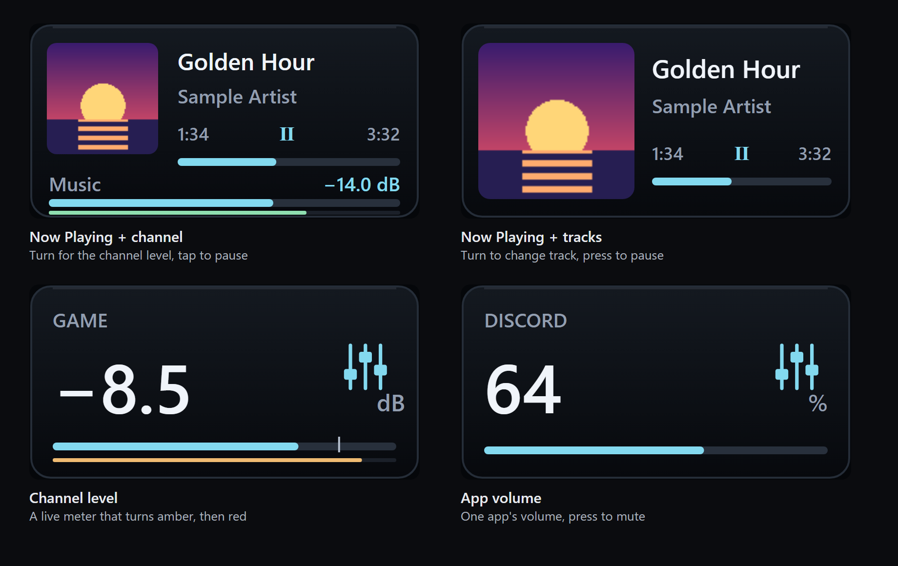

There's a plugin for the Elgato Stream Deck in the [`streamdeck`](streamdeck) folder, built for the **Stream Deck +**: each of the four dials becomes the level control for a channel (turn to change the level, press or tap to mute), and the keys can mute channels (or mute an input on some outputs only, like right-clicking Mute), load scenes, play sounds, and turn Be right back, recording, ducking and mic clean-up on or off, with the keys lighting up to match. If Sleekmeeter finds the Stream Deck app it offers to install the plugin (also in Settings → Controls & remote → Stream Deck), or double-click `Sleekmeeter-Studio.streamDeckPlugin` yourself. Then paste the Sleekmeeter Remote address once. The [plugin's readme](streamdeck/README.md) has the steps.

The dials also show what's playing, with album art, and can control one app's volume. For your other keys, the [icon pack](streamdeck/Sleekmeeter-Studio-Icons.streamDeckIconPack) adds 486 icons in the same style to the Stream Deck icon library.

**Settings → Controls & remote → Stream Deck → Save Stream Deck + profile** gives you an editable starting layout with mic, game, chat and music dials, four mute keys and keys for scenes, BRB and output switching. Import it in the Stream Deck app after installing the Sleekmeeter plugin and confirm the channels and scenes in the action settings.

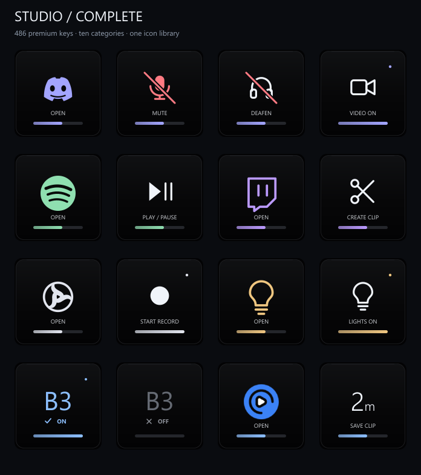

### Level history

**⋯ → Level history** (or Settings) shows how loud each channel was over the last 5 minutes to 3 hours, with a red line at 0 dB where audio distorts, plus the loudest level, the seconds spent over 0 dB and how long each channel had sound. It's the quick way to check after a stream if your mic clipped or your game drowned out your voice. It's kept in memory only while Sleekmeeter runs, and you can turn it off or clear it.

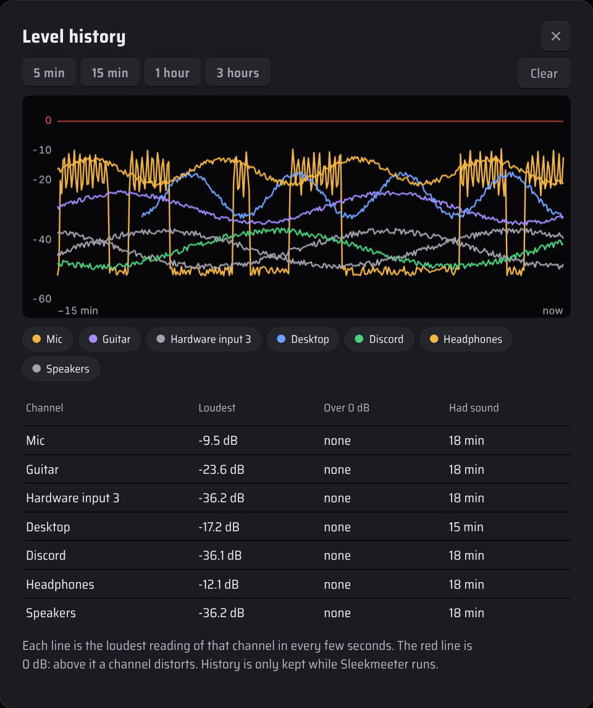

### Tray volume panel

Double-click the tray icon to open a small volume panel: one fader and mute button per visible channel. By default it is **docked**: it snaps to the corner of the screen where the taskbar and clock are, flush against both, and opens in exactly the same place every time (it works with the taskbar on any edge). Click the pin button in its header, or untick **Snap the panel to the corner** in Settings, to undock it; an undocked panel can be dragged by its header and remembers where you left it. Double-click the tray icon again or click **×** to close it, or **Open mixer** for the full window. A single click on the tray icon still shows or hides the mixer, and the tray menu has **Open volume panel** too.

**Settings → Appearance & layout → Tray volume panel** changes how it looks: **Rows** (sliders across) or **Columns** (sliders up and down, like the mixer), a size from 60% to 100% (handy on a small second screen), an opacity, and whether it shows channel icons, level meters and mute buttons. To leave a channel out of the panel but keep it in the mixer, untick **Show in the tray volume panel** in that channel's settings (click its icon). The panel follows a new theme straight away, even while it's open.

### Shortcuts and the volume overlay

Global shortcuts work in any app. The defaults are **Ctrl+Alt+M** (mute input 1), **Ctrl+Alt+Up / Down** (A1 volume) and **Ctrl+Alt+S** (show or hide Sleekmeeter); change or add them in Settings, including hold-to-talk, switching output profiles, talk-over ducking and recording. When a level changes while Sleekmeeter isn't in front — from a shortcut, a MIDI controller or a Stream Deck — a small overlay shows which channel changed and its new level. Choose which screen it appears on in **Settings → Appearance & layout → Volume overlay**, and untick **Show in the volume overlay** in a channel's settings to leave that channel out.

### Switching scenes automatically

In **Scenes → Switch automatically**, add a rule such as: when `obs64.exe` starts, load **Streaming**; when it closes, load **Default**. Sleekmeeter checks running apps every couple of seconds. If several rule apps are open, closing one goes back to the scene of the one started before it. Apps that are already running when Sleekmeeter starts don't trigger a switch. A rule can also switch your outputs and theme while the app runs (see Per-game profiles above).

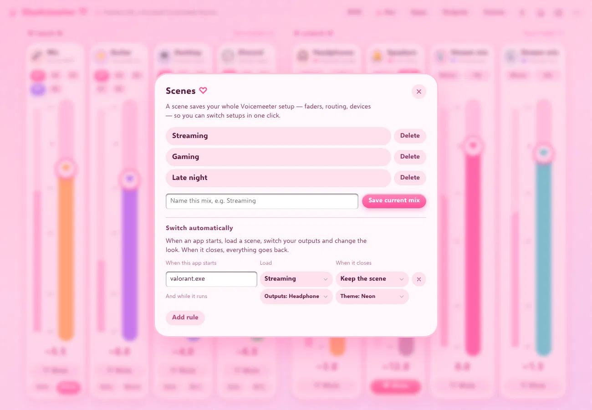

### Updates

When Sleekmeeter starts it checks this repository's latest release. If there's a newer version, an **Update to …** button appears in the header. Choose **Update now and restart** and Sleekmeeter downloads the new version, checks it against GitHub's checksum, installs it and opens again by itself, with progress shown on the button.

After an update, Sleekmeeter shows **What's new** once: the changes since the version you had, from this changelog (built in, so nothing is downloaded). **Settings → System & backup → Updates → What's new** shows them again.

Ticking **Settings → System & backup → Updates → Also offer test versions** also offers test versions from the [beta page](https://github.com/minimalhandle/SleekMeeter-beta/releases); nobody else is offered them. **Check for updates** in the same place looks straight away.

- **Installed with the installer:** installs silently in the background with no Windows prompt.
- **Installed with the MSI:** Windows asks once for permission (the usual yes/no prompt) while it installs.
- **Portable:** it replaces its own `Sleekmeeter.exe` in place, with no prompt. If the folder is read-only, use **Open the download page** instead.

You can also skip a version or turn the check off in Settings. Versions before 0.10.1 only open the release page, so update those by hand once.

### Startup

In Settings you can start Sleekmeeter with Windows (optionally straight to the tray), start Voicemeeter automatically, and hide Voicemeeter's own window when it starts. **⋯ → Show Voicemeeter window** always brings it back.

**⋯ → Focused mixer** puts faders, meters, Mute, and active sends up front. **All routes** on an input opens its full A/B grid, including A4 and A5 on Potato. The strip’s **Routing** tab also has the full grid. Turn Focused mixer off to restore your previous layout. **Settings → Appearance & layout → Channel buttons** controls whether inactive Solo, Mono and EQ buttons appear in the full mixer.

All of this is saved in `settings.json` next to the exe.

## Reporting a problem

**Settings → System & backup → About** shows which version of Sleekmeeter you're running. Sleekmeeter also keeps a log of what it does and anything that goes wrong (events only, never audio): click **Open log file** there and attach `sleekmeeter.log` to your [issue](https://github.com/minimalhandle/SleekMeeter/issues). The log lives in a `logs` folder next to the exe (or in `%LOCALAPPDATA%\Sleekmeeter\logs` if that folder can't be written to) and never grows past about 2 MB.

## Build it

### Option A: GitHub Actions (no tools needed)

Push this folder to a GitHub repository. The included workflow (`.github/workflows/build-windows.yml`) builds on a Windows runner; download **Sleekmeeter-portable** from the run's Artifacts section.

### Option B: on your PC

1. Install [Rust](https://rustup.rs) (default MSVC toolchain, with the Visual Studio C++ build tools it asks for) and [Node.js](https://nodejs.org) 20+.
2. In this folder:
   ```
   npm install
   npm run build
   ```
3. The app is at `src-tauri\target\release\sleekmeeter.exe`.
4. To make the installer, MSI and portable zip for a release, run `npm run package`. The files land in `dist\release`.

For live development with Voicemeeter running: `npm run dev`.

## Preview the UI without Windows

Open `src/index.html` in any browser. With no Voicemeeter available it runs against a simulated Voicemeeter Banana. Add `?edition=1` (Standard) or `?edition=3` (Potato) to try the other layouts, `?panel` for the tray panel, `?update` for the update button, or `?offline` for the "not running" screen.

## How it works

- `src-tauri/src/vm.rs` finds Voicemeeter through its uninstall registry key, loads `VoicemeeterRemote64.dll`, and wraps the `VBVMR_*` functions (login, get/set parameters, levels, run).
- `src-tauri/src/main.rs` polls `VBVMR_IsParametersDirty` and `VBVMR_GetLevel` about 30 times a second, sends `vm-state` and `vm-levels` events to the window, and exposes commands for setting parameters and managing scenes.
- `src-tauri/src/gain.rs` works out fades, fading mute and ducking (Voicemeeter does the fading itself with `FadeTo`); `fades.rs` connects it to Voicemeeter and handles scene fades. `recorder.rs` drives the recorder, and `devwatch.rs` restarts the audio engine when a device comes back. `outputs.rs` keeps the output profiles, `hold.rs` handles push to talk and push to mute, and `appvol.rs` reads and sets each app's volume through Windows' audio sessions.
- `src-tauri/src/settings.rs` keeps settings in `settings.json`; `win.rs` handles start with Windows and Voicemeeter's window; `apps.rs` lists running apps for automatic scenes; `update.rs` checks GitHub for new releases.
- `src/` is the interface (plain HTML, CSS and JavaScript). `engine.js` talks to the Rust side inside the app, or to the simulator in a browser. `osd.html` is the volume overlay.

Parameter names follow the Voicemeeter Remote API documentation (e.g. `Strip[0].Gain`, `Strip[3].B1`, `Bus[0].Mute`), so adding more controls is mostly a matter of adding buttons that call `engine.setFloat(...)`.

## License

Sleekmeeter is released under the MIT License (see `LICENSE`).

## Credits

Uses the [Voicemeeter Remote API](https://github.com/vburel2018/Voicemeeter-SDK) by Vincent Burel / VB-Audio, free to use in projects that interact with Voicemeeter. Voicemeeter itself is donationware from VB-Audio. Font: Saira Semi Condensed (SIL Open Font License, see `src/fonts/OFL.txt`).

Sleekmeeter is an independent project and isn't affiliated with or endorsed by VB-Audio. Voicemeeter is a trademark of VB-Audio Software.
