# Sleekmeeter

A modern face for Voicemeeter Standard, Banana and Potato. Sleekmeeter sits on top of Voicemeeter and controls it through the official Voicemeeter Remote API — Voicemeeter keeps doing the audio, Sleekmeeter is just a nicer mixer to look at and use.

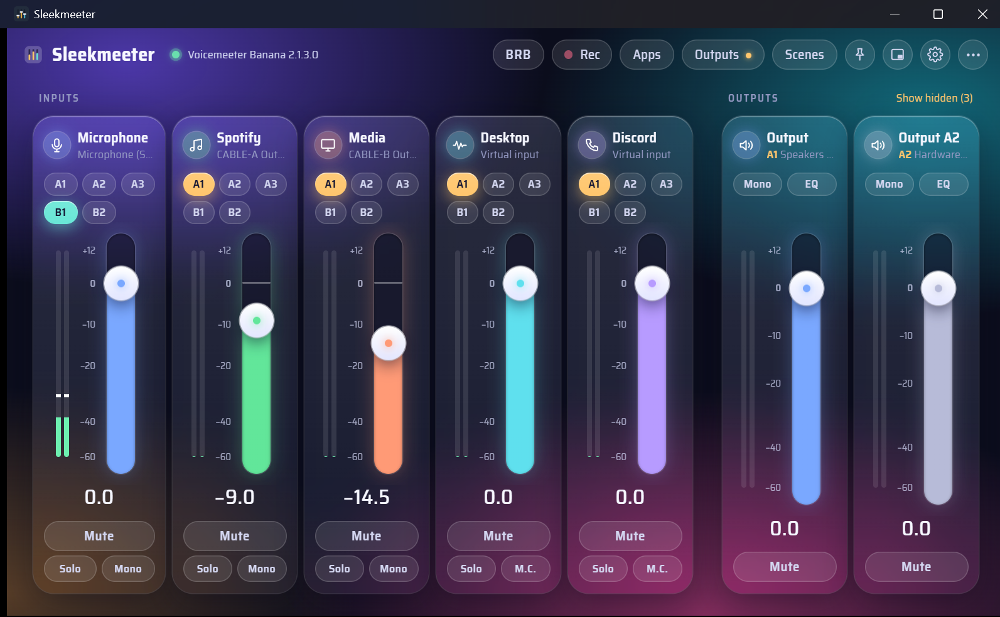

**Mini mode and the tray volume panel:** one slim row per channel, with a meter, a fader and a mute button. Double-click the tray icon to open it right above the tray.

<table>
<tr>
<td>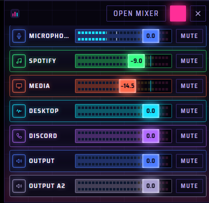</td>
<td>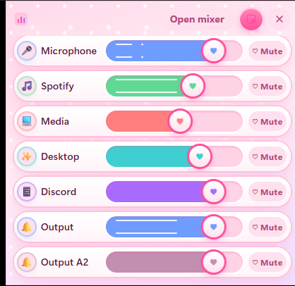</td>
</tr>
</table>

## Requirements

- Windows 10 or 11 (WebView2 comes with both)
- Voicemeeter Standard, Banana or Potato installed (Sleekmeeter loads `VoicemeeterRemote64.dll` from its install folder and adapts its layout to the edition you run)

## Install or run it

Pick one from the [Releases](../../releases) page:

| File | What it is |
| --- | --- |
| **Sleekmeeter-Setup.exe** | The easy way. Checks whether Voicemeeter is installed. If it isn't, it downloads VB-Audio's official installer for you and runs it first, then installs Sleekmeeter. |
| **Sleekmeeter-*version*.msi** | Just Sleekmeeter, for PCs that already have Voicemeeter. |
| **Sleekmeeter-*version*-portable.zip** | No install: unzip anywhere and run `Sleekmeeter.exe`. Settings and scenes are saved in a `scenes` folder next to the exe. |

Voicemeeter is made by VB-Audio and is not included; Setup downloads it from vb-audio.com. After it installs Voicemeeter, Windows needs a restart before Voicemeeter's audio drivers work.

When installed with the MSI, your settings, scenes and logs are kept in `%APPDATA%\Sleekmeeter` instead, since the install folder is read-only.

If Voicemeeter isn't running, Sleekmeeter offers to start it. Closing the window keeps Sleekmeeter in the tray; left-click the tray icon to bring it back, right-click → **Quit Sleekmeeter** to exit. Only one copy runs at a time, so starting Sleekmeeter again (say, from a pinned taskbar icon) brings back the one that's already running.

## Using the mixer

| Do this | To |
| --- | --- |
| Drag a fader (hold **Shift** for fine moves) | Change level |
| Double-click a fader | Glide back to 0 dB |
| Right-click a fader (or press Enter on it) | Type an exact level, like `-10`, `-10db` or `+3 dB` |
| Scroll over a fader (**Alt** for 0.1 dB steps) | Nudge by 1 dB |
| Focus a fader, then ↑ ↓ / PgUp PgDn / 0 | Keyboard control |
| Click **A1–A3 / B1–B2** on an input | Route it to that output |
| Double-click a name (or F2) | Rename the strip or bus in Voicemeeter |
| Click a strip's icon | Open its panel: color, icon, hide, device, pan, compressor, gate, EQ (virtual inputs) or bus mode (outputs) |
| **Scenes** | Save or recall your whole Voicemeeter setup |
| **Rec** | Open Voicemeeter's recorder (Banana and Potato) |
| Pin button | Keep Sleekmeeter on top of other windows |
| Mini mode button | Switch to a small window with one row per channel |
| Gear button | Settings: themes, fades, talk-over ducking, audio devices, startup, volume overlay, updates and global shortcuts |
| **⋯** menu | Show the Voicemeeter window, restart the audio engine, clear solos |

Each strip is as wide as its name, so names show in full, and the input and output sections stay centred in the window. Click the dB readout under a fader to type an exact level.

Pick a theme in **Settings → Appearance**: **Console** (the dark hardware desk, the default), **Analog** (warm walnut and cream), **Studio** (a light desk with dark meter windows) or **OLED black**, where everything that isn't information turns true black. The rest change the shapes as well as the colours: **Glass** (frosted translucent cards over a soft glow, faders as capsules filled with the channel's colour), **Ink** (a light page with no boxes, big thin level numbers and hairline faders), **Neon** (a dark synth night with glowing outlines and flat light-bar caps), **Terminal** (green phosphor, monospace type, square corners and [bracketed] keys), **Bubblegum** (pink and sparkly, with heart-capped candy faders and cute emoji icons for each channel), **Blueprint** (white lines on drafting-paper blue, with tick-mark faders) and **Block** (bold and flat, with thick outlines and hard shadows). The tray panel and the volume overlay follow the theme too.


<table>
<tr>
<td align="center">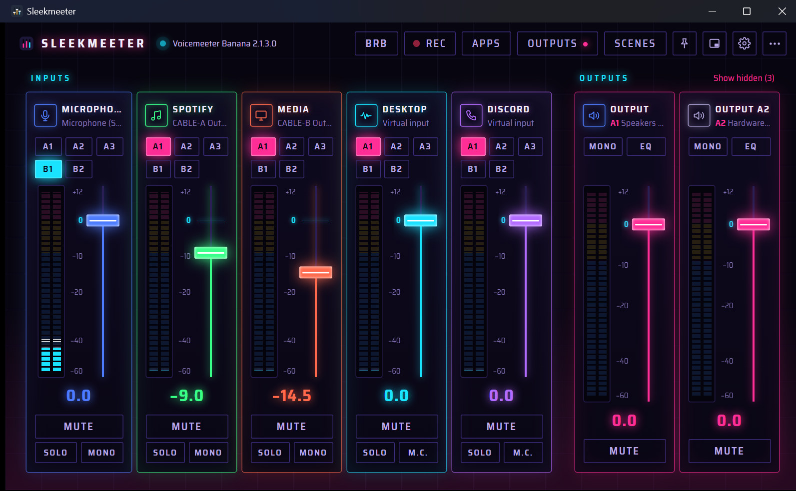<br><sub><b>Neon</b></sub></td>
<td align="center">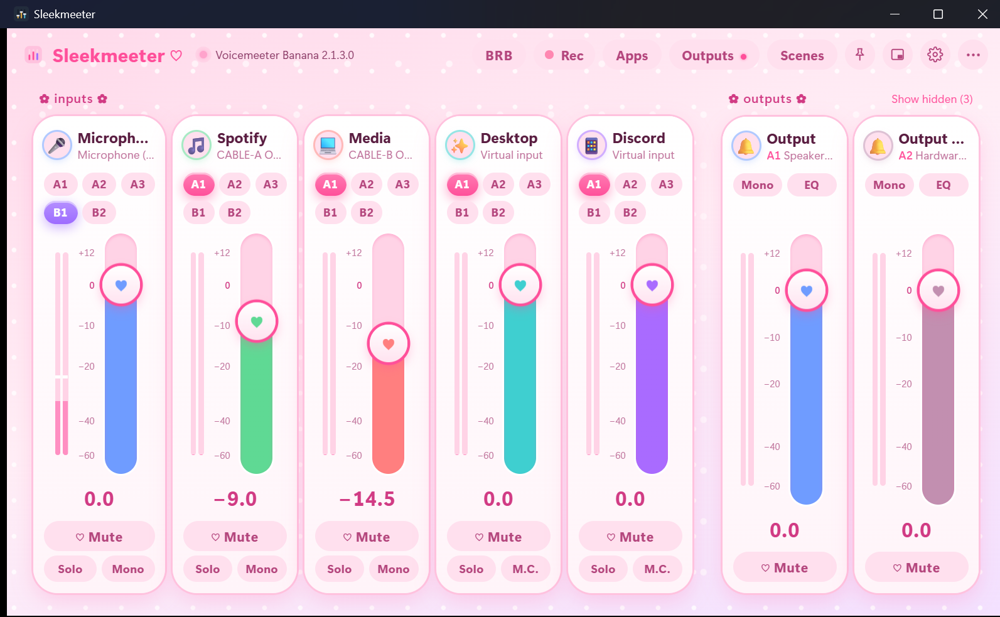<br><sub><b>Bubblegum</b></sub></td>
</tr>
<tr>
<td align="center"><br><sub><b>Glass</b></sub></td>
<td align="center">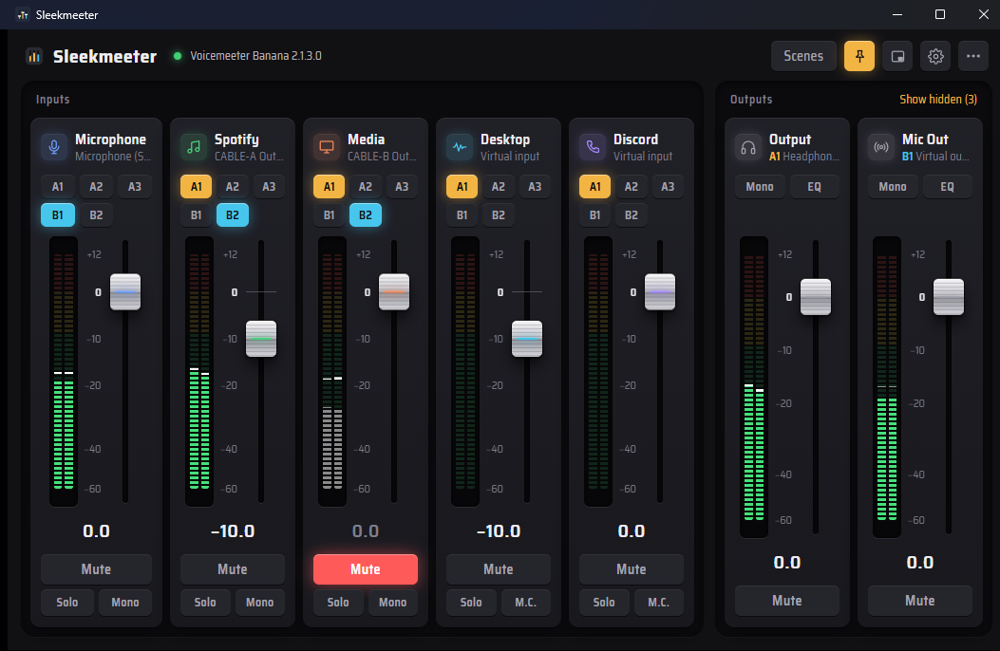<br><sub><b>Console</b> (default)</sub></td>
</tr>
<tr>
<td align="center">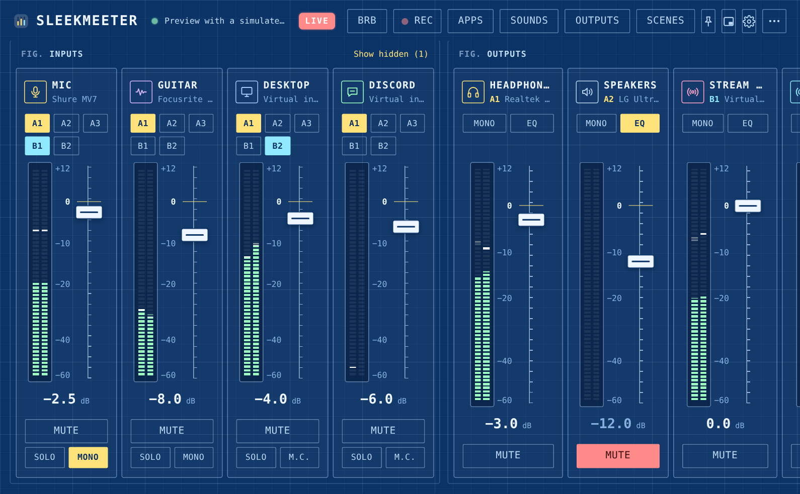<br><sub><b>Blueprint</b></sub></td>
<td align="center">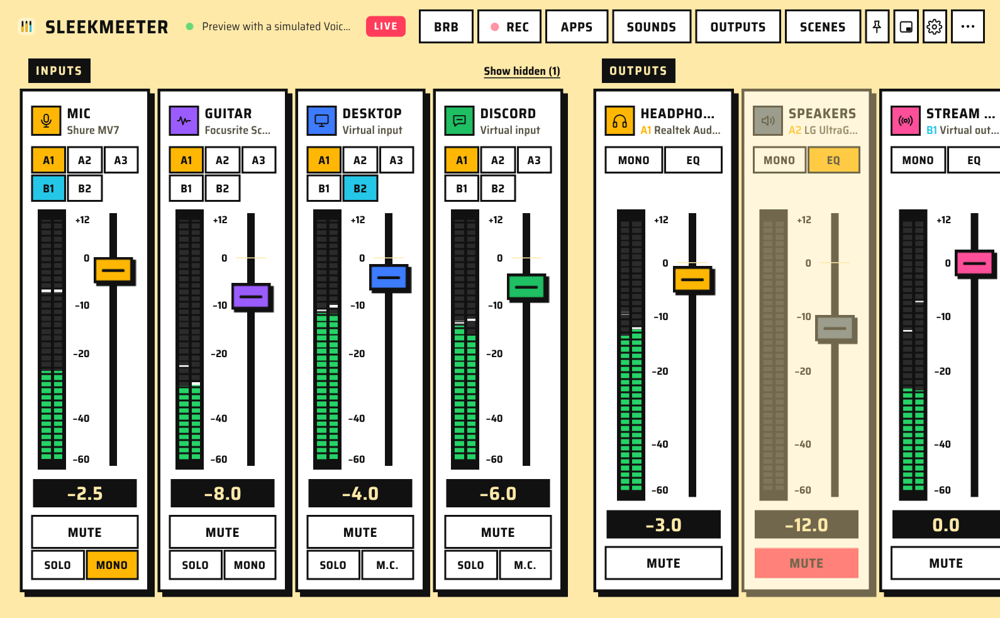<br><sub><b>Block</b></sub></td>
</tr>
</table>

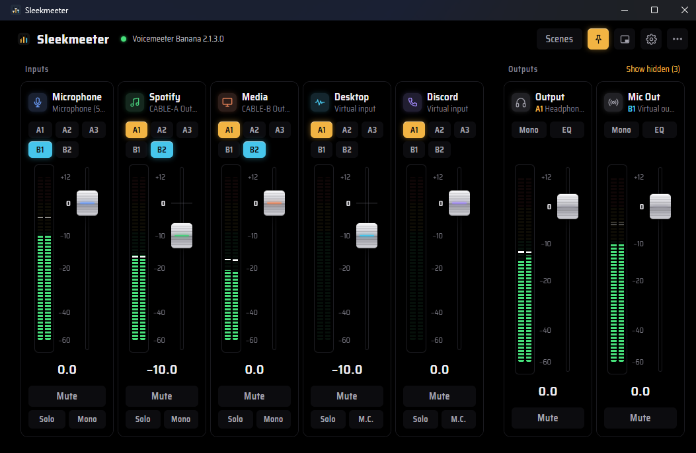

Meters show post-fader levels on the same scale as the fader, so you can see signal and fader position together. Everything stays in sync with Voicemeeter itself, MIDI controllers and other remote apps.

### Smooth fades

Mute fades out before it mutes, and unmute fades back in, so nothing clicks or jumps. Typed levels, double-click to 0 dB, volume shortcuts and scene changes glide too. Set the mute and scene fade times in **Settings → Smooth fades**, or turn fades off there. Dragging a fader is always direct.

A scene fades its levels first and then loads everything else (routing, devices, EQ). Scenes saved before 0.6 load straight away the first time; after that they fade as well.

### Talk-over ducking

Turn other audio down while you talk, like a radio DJ. In **Settings → Talk-over ducking**, pick the channel that talks (usually your mic), the channels to turn down (music, game, desktop audio) and by how much. The **Starts at** slider lights up with your voice; put the knob just under your speaking level. When you stop talking, the channels fade back after the **Back after** time.

A ducked channel shows **Ducking** on its meter. Its fader stays at your level, so you can still move it while ducked, and moving it anywhere else (Voicemeeter's own window, a MIDI controller) takes it out of ducking. You can also add a shortcut that turns ducking on or off.

### Recorder

On Banana and Potato, **Rec** in the header opens Voicemeeter's built-in recorder: record, play, pause, stop, rewind and fast forward, with a running clock that also shows in the header while you record. Choose whether to record inputs or outputs and which ones, the file format and, for WAV, AIFF and BWF, the bit depth (MP3 always records at 16-bit, because Voicemeeter's MP3 encoder distorts at higher bit depths). A meter shows how loud the recording is; if it goes over 0 dB the file will distort, so the recorder warns you to turn down what you're recording (channels you record together are added up). To play a file, click **Open a file…** or drop an audio file on the window, then pick which outputs it plays into and its level. Recordings go to the folder set in Voicemeeter's own recorder menu. A shortcut can start and stop recording from any app.

### Devices that come back

Unplug USB headphones or let Bluetooth disconnect, and Voicemeeter often stays silent on that device after it comes back until you restart its audio engine. Sleekmeeter watches the devices Voicemeeter uses. When one of them comes back, it waits a couple of seconds for Windows to set it up, restarts the engine for you and shows a short message. Turn this off in **Settings → Audio devices**.

### Output profiles

Switching between headphones and speakers usually means picking the device on each output by hand. In **Outputs** (header), name the devices your outputs are using now, like *Headphones* or *Speakers*, and click a setup to switch to it. Only the output devices change; levels, routing and the rest stay as they are. Turn on **Auto** for a setup and Sleekmeeter switches to it when one of its devices connects, then restarts the audio engine so the device is picked up. Shortcuts can switch to a chosen setup or step to the next one.

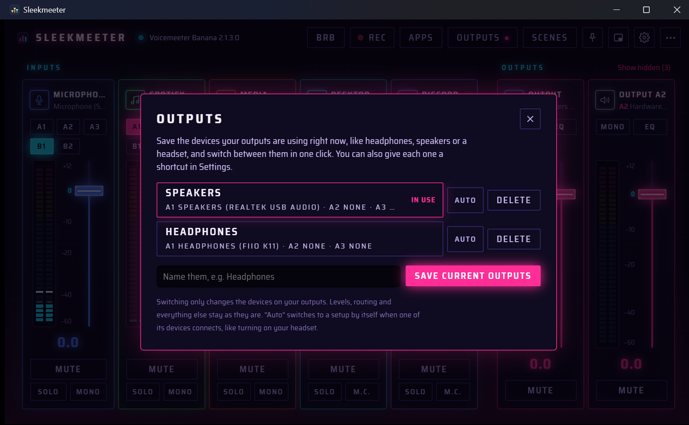

### Push to talk and push to mute

In **Settings → Shortcuts**, set an action to **Push to talk (hold)** or **Push to mute (hold)**. These act only while you hold the keys. With push to talk, the mic starts out muted, opens when you press the keys and closes shortly after you let go; **Mic stays open** sets that delay so the end of a word isn't cut off. Push to mute does the opposite, and a channel you had already muted stays muted. If you remove a push-to-talk shortcut, unmute the mic yourself once.

### App volumes

**Apps** (header) lists the programs that are playing sound with a volume slider and a mute button each, like Windows' own volume mixer. It turns an app down before Voicemeeter hears it, which is handy for Discord, a browser or a game that has no volume control of its own. A green dot means the app is playing right now. Double-click a slider to put it back to 100%.

**Send an app to another output.** The box on the right of each app chooses which playback device it plays to, for example Discord into a Voicemeeter virtual input, the same setting as Windows' *App volume and device preferences*. This one is new and uses an internal Windows feature, so if your version of Windows doesn't accept it you'll see a message instead and nothing changes.

### Stream mode: Be right back

The **BRB** button in the header does your whole "be right back" in one press, with fades: it mutes the channels you pick (your mic), turns others down (the game), and brings up a channel to play (music). Press it again (**Back live**) and everything returns exactly as it was. Choose what it does in **Settings → Stream mode: Be right back**. A shortcut can do it too (**Be right back on or off**), and so can an OBS scene.

### OBS Studio

In **Settings → OBS Studio**, connect Sleekmeeter to OBS (in OBS turn on **Tools → WebSocket Server Settings → Enable WebSocket server**; add the password there if you set one). Then you can pick what happens when OBS switches to a scene, like loading a Voicemeeter scene, or starting or ending Be right back when you switch to your BRB scene. You can also choose what happens when you go live and when the stream ends, and a red **LIVE** tag shows in the header while OBS is streaming. Twitch streams are covered because OBS tells Sleekmeeter when it goes live. Sleekmeeter only listens; it never changes anything in OBS. This needs OBS Studio 28 or newer.

### Mic level

**Settings → Mic level → Check my mic level** listens while you talk for 8 seconds and tells you whether your mic is too quiet, about right or too loud, and can set the fader for you. It aims to keep your voice peaking around −10 dB with room for a laugh or a jump scare. You can also turn on a warning when a channel goes over 0 dB, where audio distorts.

### Per-game profiles

**Scenes → Switch automatically** rules can do more than load a scene. Under each rule, pick an **output profile** and a **theme** to use while the app runs: for example, when `valorant.exe` starts, load *Gaming*, switch to *Headphones* and use the Neon theme. When the last app with a rule closes, your scene, outputs and theme go back.

### Backup, layout and the setup check

**Settings → Backup and layout** saves your settings to a file and restores them (your scenes are the .xml files in the `scenes` folder next to Sleekmeeter, so copy that too), and **Reset the layout** brings the window back to its default size and unhides every channel. **Settings → About → Check my setup** (also on the "Voicemeeter isn't running" screen) checks the things that usually go wrong: Voicemeeter and its remote library, audio devices Windows doesn't list, shortcuts that couldn't be registered, the OBS link, and whether settings can be saved.

### Soundboard

Click **Sounds** in the header to play short clips into your stream: an airhorn, a sad trombone, a bit of music. **Add a sound…** takes a wav, mp3, ogg or flac file and turns it into a button. Sounds play to the output device you pick under **Play to**. Choose one of Voicemeeter's virtual inputs (like *Voicemeeter Aux Input*) and each sound shows up in the mixer as a channel of its own, so you decide where it goes (stream, headphones or both) and turn it up or down with its fader. **Automatic** picks a Voicemeeter virtual input for you when there is one. **Edit** renames or removes sounds.

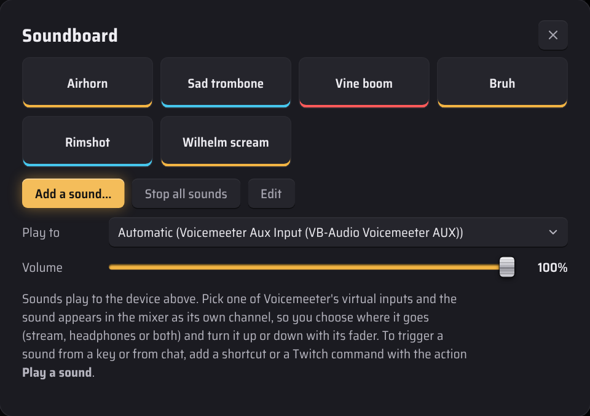

Sounds can also be played from a **shortcut** or a **Twitch chat command** (the action *Play a sound*).

### Twitch chat commands

Let chat, or just your mods, run things while you stream. In **Settings → Twitch chat commands**, enter your channel name and add commands such as `!brb` (Be right back), `!scene` (load a scene) or `!sound` (play a sound). Leave the last box empty and the command uses what's typed after it, so `!sound airhorn` plays *airhorn* and `!scene Gaming` loads *Gaming*. Other actions include muting a channel, switching output profiles, ducking and recording.

Sleekmeeter joins your chat as a silent, anonymous viewer: **no sign-in, nothing is ever posted**, and it only reacts to the exact commands you add. Choose who may use them: only you, you and your mods (the default), or everyone. A wait time stops a command from being spammed.

### Phone remote

Turn on **Settings → Phone remote** and open the address it shows on a phone or tablet on the same Wi-Fi. You get faders and mute buttons for every channel, **Be right back**, your scenes, sounds and output profiles. The long code in the address is the password, so don't share it, and **Make a new key** signs every phone out. It never leaves your home network and nothing is sent to the internet. The first time, Windows asks to allow Sleekmeeter on private networks.

### Level history

**⋯ → Level history** (or Settings) shows how loud each channel was over the last 5 minutes to 3 hours, with a red line at 0 dB where audio distorts, plus the loudest level, the seconds spent over 0 dB and how long each channel had sound. It's the quick way to check after a stream if your mic clipped or your game drowned out your voice. It's kept in memory only while Sleekmeeter runs, and you can turn it off or clear it.

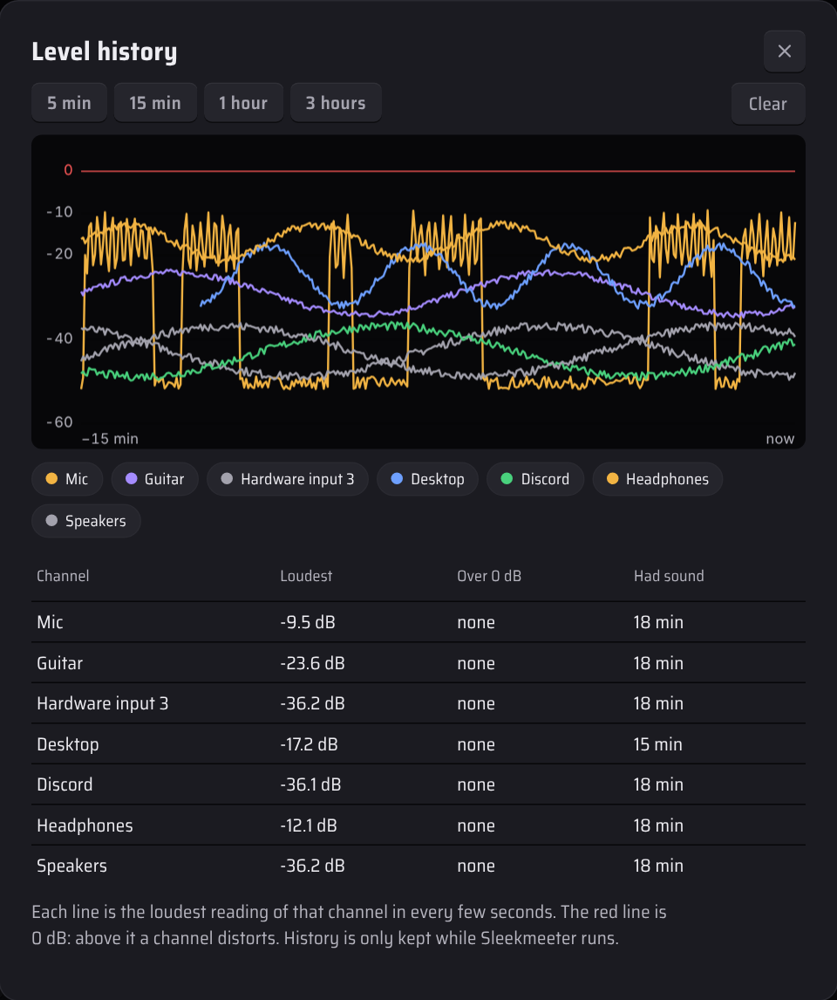

### Tray volume panel

Double-click the tray icon to open a small volume panel: one fader and mute button per visible channel. By default it is **docked**: it snaps to the corner of the screen where the taskbar and clock are, flush against both, and opens in exactly the same place every time (it works with the taskbar on any edge). Click the pin button in its header, or untick **Snap the panel to the corner** in Settings, to undock it; an undocked panel can be dragged by its header and remembers where you left it. Double-click the tray icon again or click **×** to close it, or **Open mixer** for the full window. A single click on the tray icon still shows or hides the mixer, and the tray menu has **Open volume panel** too.

### Shortcuts and the volume overlay

Global shortcuts work in any app. The defaults are **Ctrl+Alt+M** (mute input 1), **Ctrl+Alt+Up / Down** (A1 volume) and **Ctrl+Alt+S** (show or hide Sleekmeeter); change or add them in Settings, including hold-to-talk, switching output profiles, talk-over ducking and recording. When a level changes while Sleekmeeter isn't in front — from a shortcut, a MIDI controller or a Stream Deck — a small overlay shows which channel changed and its new level.

### Switching scenes automatically

In **Scenes → Switch automatically**, add a rule such as: when `obs64.exe` starts, load **Streaming**; when it closes, load **Default**. Sleekmeeter checks running apps every couple of seconds. If several rule apps are open, closing one goes back to the scene of the one started before it. Apps that are already running when Sleekmeeter starts don't trigger a switch. A rule can also switch your outputs and theme while the app runs (see Per-game profiles above).

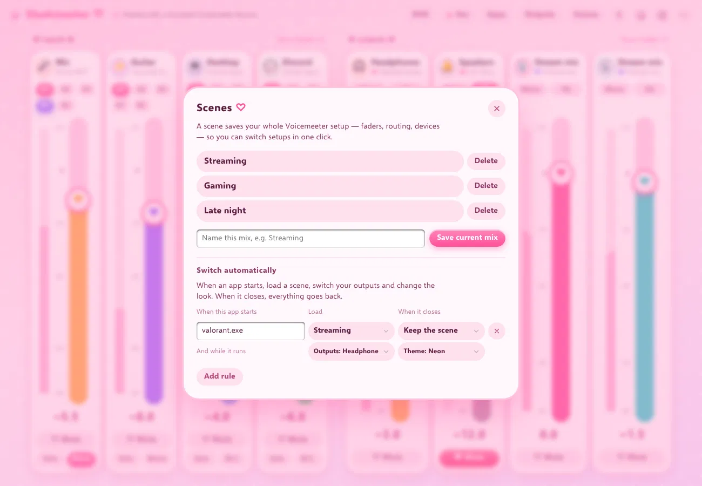

### Updates

When Sleekmeeter starts it checks this repository's latest release. If there's a newer version, an **Update to …** button appears in the header. Choose **Update now and restart** and Sleekmeeter downloads the new version, checks it against GitHub's checksum, installs it and opens again by itself, with progress shown on the button.

- **Installed with the MSI:** Windows asks once for permission (the usual yes/no prompt) while it installs.
- **Portable:** it replaces its own `Sleekmeeter.exe` in place, with no prompt. If the folder is read-only, use **Open the download page** instead.

You can also skip a version or turn the check off in Settings. Versions before 0.10.1 only open the release page, so update those by hand once.

### Startup

In Settings you can start Sleekmeeter with Windows (optionally straight to the tray), start Voicemeeter automatically, and hide Voicemeeter's own window when it starts. **⋯ → Show Voicemeeter window** always brings it back.

All of this is saved in `settings.json` next to the exe.

## Reporting a problem

**Settings → About** shows which version of Sleekmeeter you're running. Sleekmeeter also keeps a log of what it does and anything that goes wrong (events only, never audio): click **Open log file** there and attach `sleekmeeter.log` to your [issue](https://github.com/minimalhandle/SleekMeeter/issues). The log lives in a `logs` folder next to the exe (or in `%LOCALAPPDATA%\Sleekmeeter\logs` if that folder can't be written to) and never grows past about 2 MB.

## Build it

### Option A: GitHub Actions (no tools needed)

Push this folder to a GitHub repository. The included workflow (`.github/workflows/build-windows.yml`) builds on a Windows runner; download **Sleekmeeter-portable** from the run's Artifacts section.

### Option B: on your PC

1. Install [Rust](https://rustup.rs) (default MSVC toolchain, with the Visual Studio C++ build tools it asks for) and [Node.js](https://nodejs.org) 20+.
2. In this folder:
   ```
   npm install
   npm run build
   ```
3. The app is at `src-tauri\target\release\sleekmeeter.exe`.
4. To make the installer, MSI and portable zip for a release, run `npm run package`. The files land in `dist\release`.

For live development with Voicemeeter running: `npm run dev`.

## Preview the UI without Windows

Open `src/index.html` in any browser. With no Voicemeeter available it runs against a simulated Voicemeeter Banana. Add `?edition=1` (Standard) or `?edition=3` (Potato) to try the other layouts, `?panel` for the tray panel, `?update` for the update button, or `?offline` for the "not running" screen.

## How it works

- `src-tauri/src/vm.rs` finds Voicemeeter through its uninstall registry key, loads `VoicemeeterRemote64.dll`, and wraps the `VBVMR_*` functions (login, get/set parameters, levels, run).
- `src-tauri/src/main.rs` polls `VBVMR_IsParametersDirty` and `VBVMR_GetLevel` about 30 times a second, sends `vm-state` and `vm-levels` events to the window, and exposes commands for setting parameters and managing scenes.
- `src-tauri/src/gain.rs` works out fades, fading mute and ducking (Voicemeeter does the fading itself with `FadeTo`); `fades.rs` connects it to Voicemeeter and handles scene fades. `recorder.rs` drives the recorder, and `devwatch.rs` restarts the audio engine when a device comes back. `outputs.rs` keeps the output profiles, `hold.rs` handles push to talk and push to mute, and `appvol.rs` reads and sets each app's volume through Windows' audio sessions.
- `src-tauri/src/settings.rs` keeps settings in `settings.json`; `win.rs` handles start with Windows and Voicemeeter's window; `apps.rs` lists running apps for automatic scenes; `update.rs` checks GitHub for new releases.
- `src/` is the interface (plain HTML, CSS and JavaScript). `engine.js` talks to the Rust side inside the app, or to the simulator in a browser. `osd.html` is the volume overlay.

Parameter names follow the Voicemeeter Remote API documentation (e.g. `Strip[0].Gain`, `Strip[3].B1`, `Bus[0].Mute`), so adding more controls is mostly a matter of adding buttons that call `engine.setFloat(...)`.

## License

Sleekmeeter is released under the MIT License (see `LICENSE`).

## Credits

Uses the [Voicemeeter Remote API](https://github.com/vburel2018/Voicemeeter-SDK) by Vincent Burel / VB-Audio, free to use in projects that interact with Voicemeeter. Voicemeeter itself is donationware from VB-Audio. Font: Saira Semi Condensed (SIL Open Font License, see `src/fonts/OFL.txt`).

Sleekmeeter is an independent project and isn't affiliated with or endorsed by VB-Audio. Voicemeeter is a trademark of VB-Audio Software.
