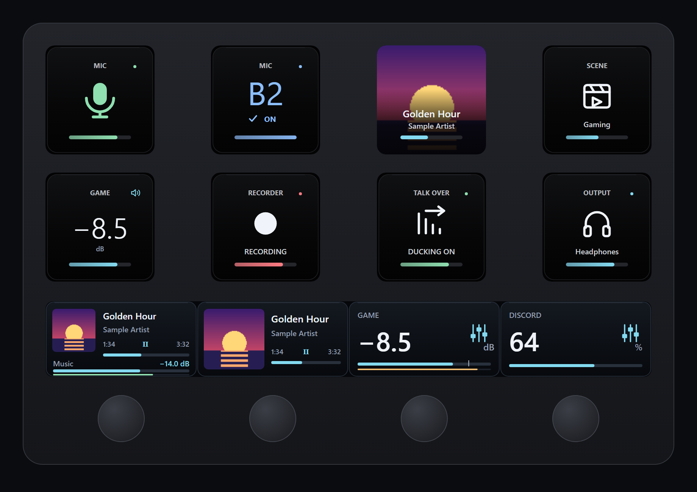

# Sleekmeeter for Stream Deck

A Stream Deck plugin for Sleekmeeter. Built for the **Stream Deck +** (four dials), and every key action works on any Stream Deck.

## Studio

Plugin 0.16.3.0 uses one look: **Studio**, with dark surfaces, centred headings, one prominent symbol or value and short gradient colour rails. Dials and Now Playing use thin level and progress bars.

Route keys make bus routing explicit: coloured bus + checkmark + ON + full pulsing rail when enabled, dim bus + cross + OFF + empty rail when disabled. ON/OFF stays visible with Show text unchecked because it communicates routing state.

Install **[`Sleekmeeter-Studio.streamDeckPlugin`](Sleekmeeter-Studio.streamDeckPlugin)** over the current plugin. All action IDs are retained, so existing keys and dials carry over.

**Live meters:** Channel and Now Playing dials show a thin meter that turns amber from −12 dB and red from −3 dB. Turn it off per dial with **Live meter**. Meters need the latest Sleekmeeter, and while one is showing Sleekmeeter keeps reading levels even with its window hidden.

### Now Playing + channel

1. Drag **Now Playing + channel** onto a Stream Deck + dial and choose **Music**, or another Sleekmeeter channel.
2. Choose **Spotify desktop** or **Current Windows media app**. Start a track in the player.
3. Rotate to adjust that channel's level. By default, press the dial to mute the channel and tap the touch strip to play/pause. Press/touch can also be configured for next/previous track, mute or no action.

The 200 × 100 touch-strip panel displays cover art, title, artist, elapsed and total time, track progress and the independently controlled channel's dB/level bar. Missing artwork gets a music placeholder; missing timeline data gets unknown-time placeholders. Media metadata depends on what the player exposes to Windows. Spotify desktop must publish a media session; Spotify in a browser can use Current Windows media app, which follows Windows' current session and may switch when another player becomes active. Show text hides the channel label, not the requested track information or level readout.

The plugin launches one hidden Windows PowerShell media-session worker only while a Now Playing action is visible. It uses the built-in Windows.Media.Control API and System.Drawing, keeps a small in-memory cover cache and exits a minute after the last Now Playing action leaves the screen, or when the parent closes. There is no Spotify account/token storage, local HTTP media server, web scraping or new npm dependency. Windows PowerShell must be available under the normal user policy. No system policy is changed. The plugin still needs the existing Sleekmeeter phone-remote connection for channel controls. Media display can remain available while that audio connection is offline.

Rebuild artwork with `node streamdeck/tests/build-studio-assets.cjs` (development-only sharp dependency), run `node --test streamdeck/tests/plugin.test.cjs streamdeck/tests/studio.test.cjs streamdeck/tests/media-worker.test.cjs`, and run `powershell -File streamdeck/tests/media-art.ps1` on Windows for the native thumbnail round-trip.

## Existing live controls

**Optional text:** select any Sleekmeeter action in Stream Deck and use **Show text** below the action options. Uncheck it for a centred symbol without the channel/profile name or status caption. Each key/dial saves its own preference; existing actions default to showing text. Colours, mute slashes, route pulses and active-output checkmarks remain live. Bus IDs, dB values on level controls and connection/setup errors remain visible.

The plugin UUID and all action UUIDs stay the same between versions, so existing keys and connection settings carry over. If artwork remains cached, quit Stream Deck from its system-tray menu and reopen it. Do not uninstall first.

Keys show live microphone states, channel-level values, bus routing and output feedback without app-name branding. The mic is green when active and red/slashed when muted. Route keys show a large bus label (amber A buses, blue B buses) and a breathing accent only when active. BRB, recorder, ducking and connection errors remain live. Existing audio action/API behaviour is unchanged.

**Output profiles:** the Next profile key displays the current profile's name and device symbol; pressing it still cycles profiles. A fixed-profile key shows its target and is dimmed when inactive. An active profile shows a coloured status dot. Speakers, headphones and wireless headphones are recognised from descriptive profile names. In the action settings, choose an explicit icon for each profile when using custom names. These overrides are stored per key, so each cycling key can be configured independently.

Audio controls operate through **Sleekmeeter**; the new Now Playing action separately displays/controls a Windows media session. The loose Discord, Spotify, Twitch, Philips Hue, OBS and Revidi icons still belong on actions supplied by those apps' plugins or shortcuts.

## Install

1. Open Sleekmeeter → **Settings → Phone remote**, turn it on, and click **Copy** next to the address.
2. Accept Sleekmeeter's offer to install the plugin (also in **Settings → Stream Deck**), or double-click **`Sleekmeeter-Studio.streamDeckPlugin`** in this folder. The Stream Deck app installs it.
3. Drag **Channel level** onto a dial, pick a channel in the settings below, and paste the address into **Connection**. Press **Connect**. You only paste it once; every other button uses the same address.

## What's in it

| Action | Where | What it does |
| --- | --- | --- |
| **Channel level** | Dial | Turn to change the level, press to mute or unmute, tap the screen to mute. The screen shows the name, level and a bar. |
| **Now Playing + channel** | Dial | Album art, title, artist and elapsed/total time. Turn for channel level, press to mute and tap to play/pause (configurable). |
| **Now Playing + tracks** | Dial | Album art, title and track time. Turn to change track, press or tap to play or pause. |
| **Output mix** | Dial | Voicemeeter Potato: one input's level on one output (its gain layer), for example less game on your stream (B3) than in your headphones. Press or tap to match the input's main level. |
| **App volume** | Dial | Pick an app such as Discord or a game. Turn to change its volume, press or tap to mute it. Needs the latest Sleekmeeter. |
| **Now Playing key** | Key | Album art, title and a progress rail on any Stream Deck. Press to play or pause, or set it to next or previous track. |
| **Mute mic** | Key | Green mic when active, red/slashed when muted. Uses your first input unless you pick another channel; existing Hold to talk mode is retained. |
| **Route to bus** | Key | Switch one input's A1 to A5 or B1 to B3 route on or off, for example your mic to B3 to put it into a game. The key is dark when the route is off, and lit with a slow pulse (amber for A buses, blue for B buses) when it's on. One key per route. |
| **Swap route** | Key | Switch between two routes with one press: the first turns on as the second turns off, and the next press swaps back. For example your headset mic or your main mic on B2, or your game on A1 (speakers) or A2 (a headset you only use for shooters). Name each side; the key shows which one is live. |
| **Mute channel** | Key | Mute or unmute; turns red when muted and shows the level. |
| **Level step** | Key | Turn a channel up or down by a set amount, or jump it to a fixed level. Hold the key to keep stepping. On Voicemeeter Potato, pick an output to change the channel's level on that output only, for example game +5 dB in your headphones (A1) without touching your stream. |
| **Load scene** | Key | Load a Sleekmeeter scene. |
| **Play sound** | Key | Play a soundboard sound. |
| **Stop sounds** | Key | Stop everything that's playing. |
| **Be right back** | Key | Turn Be right back on or off, and shows its state. |
| **Record** | Key | Start or stop the recorder, and shows its state. |
| **Talk-over ducking** | Key | Turn ducking on or off, and shows its state. |
| **Faders set** | Key | Voicemeeter Potato: press to make the input faders set one output's mix; press again for all outputs. Lit while that output is picked. |
| **Output profile** | Key | Switch to an output profile, or the next one. |

Four dials, four channels: add **Channel level** to each dial and pick Mic, Discord, Desktop and so on.

## How it works

The plugin talks to the phone-remote server Sleekmeeter already runs on your PC (the same one your phone uses). Nothing goes over the internet. It reads the state about twice a second so the keys and dials stay in step with Sleekmeeter, Voicemeeter and your other controllers.

If a button says **Sleekmeeter not found**, check Sleekmeeter is open and the phone remote is on. **Wrong key** means the address was changed with "Make a new key"; paste the new one.

## Icons

Double-click **[`Sleekmeeter-Studio-Icons.streamDeckIconPack`](Sleekmeeter-Studio-Icons.streamDeckIconPack)** to add **Studio — Complete** to the Stream Deck icon library: 486 premium 144 × 144 keys.

| Category | Icons |
| --- | --- |
| Sleekmeeter | 173 |
| OBS | 64 |
| Revidi | 61 |
| Philips Hue | 44 |
| Twitch | 39 |
| Spotify | 32 |
| Discord | 31 |
| System | 20 |
| Navigation | 13 |
| Voicemod | 9 |

The pack is artwork only: the icons go on actions supplied by each app's own plugin or shortcut.

## Files

| Path | What it is |
| --- | --- |
| `Sleekmeeter-Studio.streamDeckPlugin` | Plugin installer |
| `Sleekmeeter-Studio-Icons.streamDeckIconPack` | Icon pack installer |
| `com.minimalhandle.sleekmeeter.sdPlugin/` | Plugin source (plain Node.js, no packages) |
| `icons/` | Icon pack source, SVG masters and `catalogue.json` |
| `tests/` | Tests and the artwork builder |
| `package.ps1` | Rebuilds both installers: `powershell -File streamdeck/package.ps1` |
